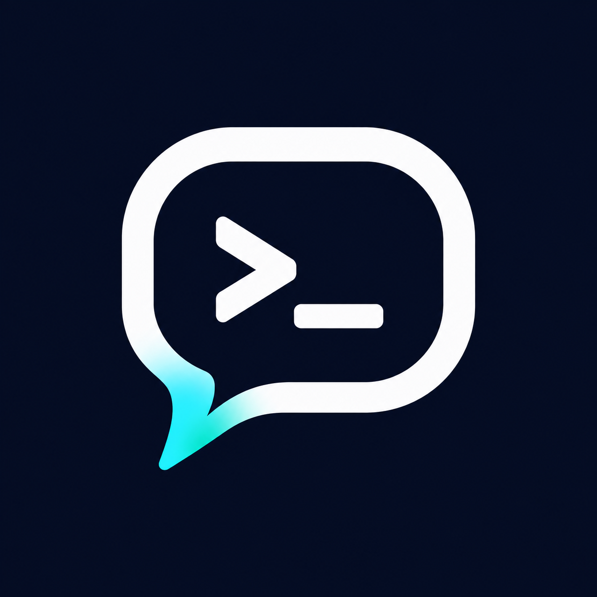

<p align="center">
  
</p>

# Tellrun — 通过 Telegram 远程使用 OpenAI Codex

**Tellrun 是可自行部署的 Telegram 机器人，基于 OpenAI Codex CLI 提供远程 AI 编程、持久化会话和流式回复。**

在服务器上运行 Tellrun，即可通过手机或电脑上的 Telegram 提交编码任务、继续对话和查看执行结果，无需一直保持 SSH 终端连接。

[English](https://github.com/chaoyue1998/tellrun/blob/main/README.md) | **简体中文**

[npm](https://www.npmjs.com/package/tellrun) · [GitHub](https://github.com/chaoyue1998/tellrun) · [问题反馈](https://github.com/chaoyue1998/tellrun/issues)

[快速开始](#安装并通过-telegram-使用-codex) · [Telegram 命令](#telegram-命令) · [终端命令](#终端命令) · [配置](#配置与数据) · [常见问题](#常见问题) · [本地开发](#本地开发)

## 功能

- **远程编码**：在 Telegram 私聊中发送任务，由服务器上的 Codex 执行。
- **图片与文件**：发送截图、照片或文件，并附带任务说明；执行中也可以追加附件。
- **会话管理**：通过 `/cwd` 指定项目目录，用 `/new` 创建命名会话，通过 `/list` 的按钮选择并继续历史对话。
- **即时反馈**：显示输入状态，实时原地更新 Markdown 回复，支持标题、列表、表格和代码块；输出期间可以继续发送命令和补充要求。
- **任务控制**：查看状态和最近结果，中断任务后直接续聊；重启后保留当前会话与任务状态。
- **定时任务**：通过 `/cron` 创建五段 Cron 计划，按服务器时区执行并接收结果。
- **审批与提问**：通过按钮处理命令、文件和权限审批；点击选项或明确回复对应问题，多题全部回答后提交。
- **权限选择**：通过 `/permissions` 选择 Codex 的四种权限模式，选择会保存并用于后续任务。

## 安装并通过 Telegram 使用 Codex

### 1. 准备环境

- **Node.js ≥ 24.5.0**。
- **[Codex CLI](https://github.com/openai/codex)**：在运行 Tellrun 的同一系统用户下安装并完成登录，确认可以在终端正常使用。

### 2. 安装并配置

```sh
npm install -g tellrun
tellrun setup
```

### 3. 在 Telegram 中开始对话

打开与机器人的私聊，依次发送以下消息，将示例目录替换为服务器上实际存在的项目绝对路径：

```text
/start
/cwd /home/you/projects/my-app
帮我了解这个项目，说明主要模块和启动方式。
```

未设置 `/cwd` 时，工作目录默认为服务启动目录；后台服务默认使用当前用户的主目录。切换目录会开始新会话。

## Telegram 命令

服务启动时自动注册英文命令菜单，可通过聊天输入框旁的菜单按钮或输入 `/` 选择命令。

| 命令                  | 作用                                                    |
| --------------------- | ------------------------------------------------------- |
| `/new [名称]`         | 创建并切换到新会话，名称可省略                          |
| `/list`               | 分页显示当前项目会话，每页 10 个，支持上下翻页和点击切换 |
| `/cwd`                | 查看当前工作目录                                        |
| `/cwd /absolute/path` | 切换工作目录并开始新会话                                |
| `/status`             | 查看版本更新、连接、目录、会话 ID、模型、权限和任务状态 |
| `/last`               | 查看当前选中会话最近已结束轮次的状态与完整结果          |
| `/interrupt`          | 中断当前任务，结束后可直接发送新消息                    |
| `/stop`               | 停止当前 Codex 会话中的所有后台终端                     |
| `/model`              | 查看当前选择，通过按钮选择模型和推理强度                |
| `/permissions`        | 选择后续任务的权限模式                                  |
| `/cron`               | 查看、创建、删除或启停定时任务                          |
| `/restart`            | 重启 Tellrun 并重新加载配置，保留会话与任务状态         |
| `/update`             | 将 Tellrun 升级信息交给 Codex 执行                      |
| `/help`、`/start`     | 查看使用说明                                            |

### 会话管理

会话由 Codex 保存，新建或切换会话会保留当前模型与权限设置。

- **查看与切换**：`/list` 按最近更新时间分页列出工作目录与当前目录完全一致的未归档会话，每页 10 个。通过 Previous / Next 按钮在原消息中翻页并查看页码，点击会话按钮即可切换，当前会话以 ✓ 标记。列表包含 Tellrun 和其他 Codex 客户端创建的会话，不包含子 Agent 会话。列表有效期为 10 分钟，再次发送 `/list` 可刷新。
- **新建会话**：`/new [名称]` 创建并切换到新会话，省略名称时使用 `New session`；尚未发送消息的空会话也会保存。
- **操作确认**：新建或切换会话后，等待成功确认再发送任务。如果无法确认会话是否创建成功，先用 `/list` 检查，再决定是否重试。
- **任务控制**：`/stop` 停止当前会话中的所有后台终端；`/interrupt` 中断当前任务。确认任务中断后，可直接发送新消息，在同一会话中继续对话。

### 定时任务

| 命令                                            | 作用                                                                        |
| ----------------------------------------------- | --------------------------------------------------------------------------- |
| `/cron`                                         | 列出当前聊天的计划 ID、启用状态、表达式、时区、目录、任务描述和下次执行时间 |
| `/cron add <分> <时> <日> <月> <周> <任务描述>` | 创建并启用五段 Cron 计划，任务描述可以包含空格                              |
| `/cron del <id>`                                | 删除计划及其待执行触发                                                      |
| `/cron enable <id>`                             | 启用计划，从下一个匹配时间开始执行                                          |
| `/cron disable <id>`                            | 禁用计划并清空待执行触发                                                    |

例如，每个工作日的服务器时间 09:00 检查当前项目：

```text
/cron add 0 9 * * 1-5 检查项目并汇报问题
```

## 终端命令

在运行 Tellrun 的电脑或服务器上，以配置 Tellrun 的同一系统用户执行。后台服务使用 Linux systemd 或 macOS launchd；前台运行使用 `tellrun run`。

| 命令                              | 作用                                                                                                        |
| --------------------------------- | ----------------------------------------------------------------------------------------------------------- |
| `tellrun setup`                   | 交互配置，并选择启动服务、启用自启或仅保存配置；需要交互式终端                                              |
| `tellrun run`                     | 前台运行，适合终端诊断或外部进程管理器托管；使用 `Ctrl+C` 停止                                              |
| `tellrun start [--enable]`        | 创建或更新当前用户的服务定义，并启动后台服务；加 `--enable` 启用自动启动（Linux 开机、macOS 登录时）        |
| `tellrun stop`                    | 停止后台服务，保留服务定义与自启设置                                                                        |
| `tellrun restart`                 | 重启后台服务，加载新配置或新版本，并更新 Node.js 和 CLI 入口路径                                            |
| `tellrun status`                  | 查看服务状态、自启状态、配置与数据路径                                                                      |
| `tellrun logs [-f]`               | 查看最近 100 条后台日志；加 `-f` 或 `--follow` 持续跟随，使用 `Ctrl+C` 退出查看                             |
| `tellrun uninstall`               | 统一移除服务；全局安装同时卸载当前 npm 包，保留用户数据                                                     |
| `tellrun -h`、`tellrun --help`    | 显示总帮助                                                                                                  |
| `tellrun help [命令]`             | 显示总帮助或子命令帮助；也可使用 `tellrun <命令> -h` 或 `tellrun <命令> --help`，例如 `tellrun logs --help` |
| `tellrun -V`、`tellrun --version` | 显示当前 CLI 版本；短参数为大写 `-V`                                                                        |

### 升级

```sh
tellrun stop
npm install -g tellrun@latest
tellrun restart
```

配置与状态保存在 `~/.tellrun/`，全局包升级会保留这些数据。升级 Node.js 或 Tellrun 后，`restart` 会更新服务使用的 Node 和 CLI 入口路径。

### 卸载

```sh
tellrun uninstall
```

停止并移除当前用户的后台服务，再从当前安装前缀卸载 Tellrun 的 npm 全局包。配置、状态、附件及应用日志保留在 `~/.tellrun/`，卸载完成后会提示自行删除。Linux 用户 linger 设置保持不变。

## 配置与数据

运行 `tellrun setup` 创建或更新配置，已有 Bot Token 可留空保留原值。

| 路径                         | 内容                                                                     |
| ---------------------------- | ------------------------------------------------------------------------ |
| `~/.tellrun/config.json`     | Bot Token、授权用户 ID、Codex 路径和可选代理                             |
| `~/.tellrun/state.json`      | 当前会话、活动任务、最近结果、定时计划与待执行触发、交互、回复和去重状态 |
| `~/.tellrun/attachments/`    | 用户上传的图片与文件，按独立标识保存，避免同名覆盖                       |
| `~/.tellrun/tellrun.service` | Linux 后台服务定义                                                       |
| `~/.tellrun/tellrun.plist`   | macOS 后台服务定义                                                       |
| `~/.tellrun/tellrun.log`     | macOS 服务诊断日志，可通过 `tellrun logs` 查看                           |

### 配置参数

`~/.tellrun/config.json` 的参数配置：

| 参数                | 类型               | 要求 / 默认行为                | 说明                                                                                       |
| ------------------- | ------------------ | ------------------------------ | ------------------------------------------------------------------------------------------ |
| `telegram.token`    | 字符串             | 必填，无默认值                 | 从 BotFather 获取的机器人 Token。                                                          |
| `telegram.ownerId`  | 正整数或数字字符串 | 必填，无默认值                 | 本人 Telegram 数字用户 ID，用于授权访问，不是 `@用户名`。建议使用数字形式。                |
| `telegram.proxyUrl` | 字符串             | 可选；省略时继承运行环境的代理 | 支持 `http://` 或 `https://` 代理地址；设为 `""` 时明确直连。                              |
| `codexPath`         | 字符串             | 可选，默认 `"codex"`           | Codex 命令名或可执行文件路径。命令名按 `PATH` 查找；`tellrun setup` 保存解析后的绝对路径。 |

配置在进程启动时读取。手动修改后运行 `tellrun restart`。

## 常见问题

### 机器人没有回复怎么办？

确认是在私聊中使用、配置的用户 ID 正确。检查运行 Tellrun 的设备能否正常访问 Telegram；如使用代理，确认代理配置正确且连接可用。查看 `tellrun logs` 排查错误；前台运行时查看终端输出。

### 服务重启后会重新执行任务吗？

尚未派发的任务会保留；执行状态不确定的任务不会自动重跑。通过 `/status`、`/last` 和本机会话核对状态后，可直接发送新消息。开始新轮次前，Tellrun 会检查 Codex 会话是否空闲。

## 本地开发

```sh
git clone https://github.com/chaoyue1998/tellrun.git
cd tellrun
npm ci
npm run build
node dist/cli.js setup
npm run dev
```

在配置向导中选择仅保存配置，再启动开发进程。开发环境与全局安装共用 `~/.tellrun/`，请先停止已有实例。也可参考仓库中的 [.env.example](https://github.com/chaoyue1998/tellrun/blob/main/.env.example)，创建 `.env` 提供开发配置。

| 命令            | 用途                     |
| --------------- | ------------------------ |
| `npm run dev`   | 监听源码并自动重启       |
| `npm run check` | 格式、静态检查与类型检查 |
| `npm run build` | 编译到 `dist/`           |
| `npm start`     | 运行编译产物             |

如果让 Codex 修改 Tellrun 自身，使用 `npm run build` 后执行 `npm start`，避免源码监听重启打断任务。

## 许可证

[MIT](https://github.com/chaoyue1998/tellrun/blob/main/LICENSE)
