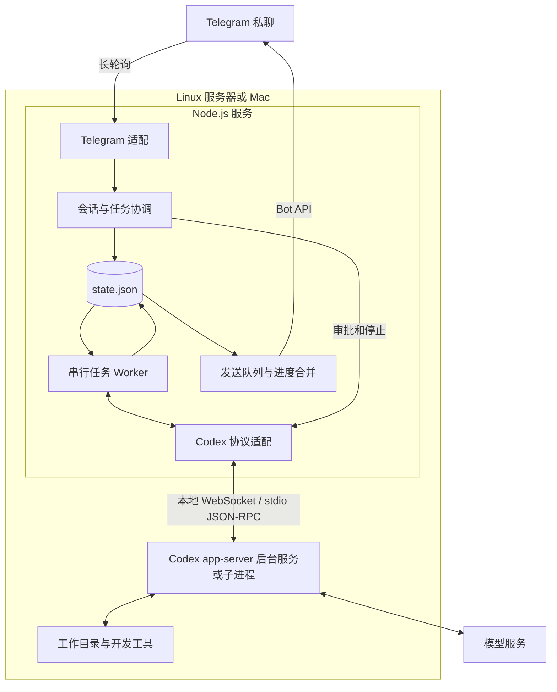

# Tellrun 架构与技术选型

首版采用 Node.js 常驻服务，使用 grammY 接入 Telegram，使用 Codex app-server 执行任务，以 JSON 文件保存配置、会话、任务和待发送回复。编码任务默认全局串行；状态、审批、补充输入和停止通过独立控制路径处理。

范围与验收见[产品需求文档](prd.md)。本方案面向个人使用，先实现 Telegram + Codex。其他 IM 与 Claude 等 Agent 是后续两个独立的扩展方向。当前已接通会话创建、列表与切换、串行执行、续聊、停止、审批与结构化提问、定时计划、持久化恢复和后台管理命令；通用任务队列、工具进度摘要及 Linux 真实部署验收仍待完成。

当前实现沿用现有技术栈和单进程结构。入站去重、任务与 outbox 的原子保存、单实例约束和最小停止能力随真实任务一起接入；本地 Codex 后台连接使用 ws，不新增测试文件。

项目中的提示语言默认是英文。
README.md 是项目主页展示，保持简单整洁。

## 核心架构决定

| 决策           | 首版方案                                                 | 原因与边界                                           |
| -------------- | -------------------------------------------------------- | ---------------------------------------------------- |
| 服务形态       | 全局 npm CLI + 单进程 Node.js 后台服务，内部按职责分模块 | CLI 管理配置与启停，后台进程持续处理消息和任务       |
| CLI 与交互配置 | Commander + @clack/prompts                               | 提供子命令、帮助和配置向导；不引入通用依赖注入框架   |
| IM 框架        | grammY，Telegram 长轮询                                  | 入口是 Bot 消息与按钮；无需公网入站接口              |
| HTTP 框架      | 首版无需引入；需要 Webhook 或管理 API 时采用 Fastify     | 避免为当前没有的 HTTP 业务增加服务层                 |
| Codex 接入     | app-server，本地 WebSocket 或 stdio 双向 JSON-RPC        | 需要完整的会话、审批、问题和中断交互                 |
| Codex 进程     | 优先复用本机后台服务，不可用时启动独立子进程             | 复用空闲会话的写锁，任务仍串行并沿用持久化 thread ID |
| 数据           | Node.js 文件接口 + JSON                                  | 配置与状态分开保存，使用原子替换                     |
| 调度           | 文件中的任务记录 + 单个 Worker                           | 队列状态可恢复；控制消息不等待编码任务               |
| 定时计划       | Croner 五段解析 + 独立调度循环 + JSON 持久化              | 使用服务器时区，串行执行，忙碌时合并等待触发        |
| 消息发送       | 本地 outbox + 进度合并                                   | Telegram 故障不改变编码任务的执行结果                |
| 部署           | npm 全局安装，Linux systemd 或 macOS launchd 用户服务    | 配置向导完成初始化，由系统管理后台运行与故障重启     |
| 扩展           | 按 Agent、IM、核心业务和存储组织模块，共用必要的消息类型 | 保持职责清晰，不为分层额外引入基类、注册器或重复转发 |

Telegram 使用长轮询主动接收更新，Bot API 同时提供发送消息及按钮回调能力。[grammY 长轮询说明](https://grammy.dev/guide/deployment-types)

Codex app-server 提供线程、轮次、执行事件与审批交互；官方把需要这些能力的自定义客户端指向 app-server。它目前仍标记为实验性，因此 M0 必须固定 CLI 版本并验证协议，不能只凭类型定义判定兼容。[OpenAI 官方 app-server 文档](https://learn.chatgpt.com/docs/app-server)、[SDK 使用边界](https://learn.chatgpt.com/docs/codex-sdk)

## 框架与库

下列应用依赖已安装并固定至 lockfile；Codex 的目标 Linux 协议兼容性仍由 M0 验证。运行时和 Codex 升级分别验证，不在服务启动时自动追随 latest。

| 用途           | 选择                 | 版本 / 状态           | 使用方式                                                           |
| -------------- | -------------------- | --------------------- | ------------------------------------------------------------------ |
| 运行时         | Node.js              | 24.22.1               | `.nvmrc` 指定版本，通过 nvm 切换；ESM，生产运行编译后的 JavaScript |
| 包管理         | npm                  | 使用 Node.js 自带版本 | 提交 `package-lock.json`，使用 `npm ci` 安装                       |
| 语言           | TypeScript           | 7.0.2                 | strict + NodeNext；类型检查与构建                                  |
| CLI            | commander            | 15.0.0                | 子命令、参数与帮助                                                 |
| 配置向导       | @clack/prompts       | 1.8.1                 | 文本输入、字段校验与取消处理                                       |
| Telegram       | grammy               | 1.46.0                | 消息、命令、InlineKeyboard、回调、长轮询                           |
| Telegram 重试  | @grammyjs/auto-retry | 2.0.2                 | 429、5xx 最多重试两次；网络错误上抛；整次调用另设超时              |
| Cron 解析      | croner               | 11.0.0                | 五段表达式校验与时区计算，执行由持久化调度循环控制                 |
| Codex 后台连接 | ws                   | 8.22.0                | 通过 Unix socket 上的 WebSocket 复用本机 app-server                |
| Codex 请求管理 | json-rpc-2.0         | 1.8.1                 | 请求编号、响应匹配、超时和断线时释放等待中的请求                   |
| 数据校验       | zod                  | 4.6.7                 | 配置及应用边界数据校验                                             |
| 日志           | pino                 | 10.4.0                | JSON 日志、关联标识与脱敏                                          |
| 开发运行       | tsx                  | 4.23.15               | 本地监听与调试；生产用 tsc 构建产物                                |
| 测试           | 暂不引入             | 未安装                | 使用静态检查、类型检查、编译与临时目录运行校验，不新增测试代码     |
| 格式与静态检查 | @biomejs/biome       | 2.6.3                 | 保持一套格式化与 lint 工具                                         |
| Codex          | Codex CLI            | 本机检测到 0.165.0    | 目标 Linux 验证后固定；生成对应协议类型                            |

Node.js 24 当前列为 LTS；grammY 提供 Node.js / TypeScript 开发路径。auto-retry 的 `maxDelaySeconds` 限制 Telegram 返回的 `retry_after`，不代表所有请求的总超时。当前安装版本的网络错误重试不消耗 `maxRetryAttempts`，因此显式启用 `rethrowHttpErrors`，并为整次调用设置可取消的截止时间。[Node.js](https://nodejs.org/en/download)、[grammY](https://grammy.dev/guide/getting-started)、[auto-retry](https://grammy.dev/plugins/auto-retry)

库版本依据各包的 npm 元数据，可从 [grammy](https://www.npmjs.com/package/grammy)、[TypeScript](https://www.npmjs.com/package/typescript) 等包页面复核。工程配套使用 npm，@types/node 与 Node.js 24 对齐。

首版以 grammY 承担 IM 入口，轻量 CLI 层管理安装后的交互配置与后台服务。[Commander](https://github.com/tj/commander.js) 提供命令解析与帮助，[Clack](https://github.com/bombshell-dev/clack) 提供配置向导。Fastify 留给后续 HTTP 入口；NestJS 的模块和依赖注入体系暂时没有对应需求。Codex 已承担 Agent 执行循环，因此首版直接接入其运行时。状态文件中的任务记录是执行事实来源，当前规模无需 Redis / BullMQ。

## 分发与命令行入口

CLI 与打包入口已接入，可使用 `npm pack` 的本地产物全局安装。本轮不执行 npm 发布；发布后通过 `npm install -g tellrun` 安装，再运行 CLI 完成交互配置和后台启动。以下命令已实现，Linux systemd 的真实服务验收仍需在服务器完成。

| 命令                      | 目标行为                                                                                                            |
| ------------------------- | ------------------------------------------------------------------------------------------------------------------- |
| tellrun                   | 无参数时显示总帮助                                                                                                  |
| tellrun setup             | 交互填写 Bot Token、本人 ID，检查 Codex 路径与运行环境；保存后可启动后台服务并设置自动启动                          |
| tellrun start             | 检查配置、创建或更新用户服务并启动；重复调用不创建第二个实例；--enable 在 Linux 启用开机自启，在 macOS 启用登录自启 |
| tellrun stop              | 停止后台服务及受管理子进程，等待实际结束后报告结果                                                                  |
| tellrun restart           | 完成停止后重新启动；用于配置变更或 npm 升级后加载新版本                                                             |
| tellrun status            | 查询服务管理器状态并展示配置、数据目录；不启动第二个业务进程                                                        |
| tellrun logs              | 展示最近 100 条后台日志；-f 或 --follow 持续跟随，凭据不进入命令行参数                                              |
| tellrun run               | 前台运行服务，供 systemd、launchd 和本地诊断使用；不进行交互配置                                                    |
| tellrun uninstall         | 统一移除用户服务；全局安装先校验位置再卸载当前前缀内的 npm 包，源码或本地依赖保留；保留用户数据并提示自行删除   |
| `tellrun -h`、`tellrun --help` | 显示总帮助；各子命令也支持 -h / --help                                                                           |
| tellrun help [command]    | 显示总帮助或指定子命令的帮助                                                                                        |
| `tellrun -V`、`tellrun --version` | 显示当前 CLI 版本                                                                                             |

面向用户的完整命令表、参数和示例见 [终端命令](../README.zh-CN.md#终端命令)、[Telegram 命令](../README.zh-CN.md#telegram-命令) 和 [本地开发脚本](../README.zh-CN.md#本地开发)。

`setup` 由用户显式执行，npm 安装脚本仅承担包安装所需工作。交互取消时保留原配置，Token 使用明文输入，已有配置时留空保留原值；校验成功后再原子写入配置。CLI 的帮助、版本和状态命令不加载会加载运行状态或启动轮询的业务入口。

`uninstall` 是 Linux、macOS 的统一卸载入口。源码或本地安装移除用户服务后保留源码或本地依赖并提示自行清理，不要求 npm 可用。全局安装优先查找当前 Node.js 对应的 npm，显式指定安装前缀并核对真实包路径；npm 预检失败时不移除服务，服务移除失败时不卸载包。Linux 未运行 systemd 且不存在应用服务定义、用户注册链接及默认启动目标链接时才跳过服务管理；失效链接也视为已有服务痕迹。npm 卸载强制保留无颜色的警告，包目录仍存在或出现 cleanup 警告时报告清理未完成，并提示检查包目录和 bin 下的隐藏残留；失败时使用 npm 直接重试，不依赖可能已移除的 tellrun 入口。成功后提示用户自行删除 `~/.tellrun/`，命令不删除配置、状态、附件或应用日志，也不修改 Linux 用户 linger 设置。

包已移除 `private: true`，通过 `bin` 暴露带 Node shebang 的 CLI；`files` 白名单包含编译产物和文档，`prepack` 在打包前完成构建。安装用户不需要源码仓库、TypeScript 或 tsx。用户配置与数据统一定位到当前用户的 `~/.tellrun/`，任何命令均可从任意目录执行。[npm 包字段](https://docs.npmjs.com/cli/v11/configuring-npm/package-json/)

发布验收使用实际 `npm pack` 产物，在临时安装前缀全局安装后，从包外目录调用 CLI；检查 bin、运行依赖和配置、状态文件的读写。升级前停止服务并备份数据，升级后重新解析 Node 与包入口路径、更新服务定义并启动；状态文件损坏或写入失败时停止服务并保留原文件。

## 模块组织与依赖方向

| 模块                                        | 职责                                                         |
| ------------------------------------------- | ------------------------------------------------------------ |
| src/cli.ts                                  | CLI 命令解析与配置向导；只在 run 时动态加载后台业务入口      |
| src/service.ts                              | 共用后台命令接口，按操作系统选择服务管理器                   |
| src/uninstall.ts                            | 核对 npm 全局安装位置，串行移除服务和包，提示手动清理数据   |
| src/systemd.ts                              | systemd 用户服务、linger、启停、状态与日志                   |
| src/launchd.ts                              | macOS 用户服务、登录自启、就绪确认、启停与日志               |
| src/main.ts                                 | 组装组件、状态加载、启动和退出；只在这里选择具体 IM 与 Agent |
| src/config.ts、src/logger.ts                | Telegram 凭据与本人身份校验、结构化日志                      |
| src/im/telegram.ts                          | grammY 接入、本人验证、入站标准化、回复与连接生命周期        |
| src/agents/codex.ts                         | Codex app-server 连接、协议校验、会话创建或恢复、执行与中断  |
| src/agents/codex-rpc.ts                     | 模型查询与任务连接共用的 RPC 收发、初始化、超时与断线清理    |
| src/agents/codex-interaction.ts             | 审批与提问请求的校验、交互内容转换和文件变更格式             |
| src/core/relay.ts                           | 平台无关的命令处理、会话选择和串行任务执行                   |
| src/core/menus.ts                           | 权限、模型与推理选择规则、菜单阶段流转及回复文案             |
| src/core/cron.ts                            | Croner 解析、定时计划管理、触发合并与调度恢复                |
| src/core/types.ts                           | 实际跨模块复用的来源、消息、Agent 接口和执行结果             |
| src/storage/store.ts、src/storage/schema.ts | JSON 状态读写、结构校验与业务操作                            |
| src/storage/lock.ts                         | 单实例锁的获取、旧锁回收与所有权释放                         |
| src/storage/json.ts                         | 配置与状态共用的 JSON 原子写入                               |

Telegram SDK 类型仅在 IM 连接模块使用，Codex RPC 类型仅在 Agent 模块使用。核心层只处理应用自己的消息与回复，通过存储模块暴露的操作读写状态；不直接使用 grammY 或 Codex 协议。IM 来源标识统一为字符串，避免把 Telegram 数字 ID 的假设带到其他平台。

当前依赖关系为 `main → 组件组装`，`im → 统一消息处理入口 → core → 存储操作`。核心层通过 `Agent` 接口执行和停止任务，IM 独立读取 outbox 发送回复。Worker 保留在核心模块，协议处理保留在 Agent 模块，不额外拆出转发层。

菜单规则由 core/menus 实现，store 为其提供当前状态读取、事务更新和回复入队接口，并保留原有调用入口。菜单选择、入站去重、按钮清理与回复仍合并为一次原子保存；菜单模块不直接操作文件或 IM API。Codex 查询与任务复用 RPC 实现，各自保持独立连接；通信模块只处理收发与连接故障，会话恢复、审批和任务取消仍由 Codex 适配器决定。

按实际复用抽取函数和共享类型，新增前检查现有定义。避免为单一用途拆出多层 Controller / Service / Repository、抽象基类和通用插件注册器；对公开函数、关键逻辑和必要常量添加简洁中文 JSDoc。

## 入站消息与执行流程

以下是任务链路。当前已实现入站去重、任务及回复的原子保存、独立执行和发送，以及回复文本的流式预览；工具进度摘要留到后续。回调应答只负责关闭客户端提示，不创建任务。

1. grammY 收到 Update，先验证授权用户和私聊范围。

2. 标准化消息保留聊天来源、事件 ID 和消息内容。按聊天来源与事件 ID 去重，将入站标识、任务及必要回复作为同一份快照保存，并在创建任务时固定会话和工作目录快照。任务成功提交不生成接收回执；重复事件直接忽略，不重复创建任务或回复。

3. 状态文件保存后结束入站处理，把耗时执行交给 Worker；不能在 Bot handler 中等待整个 Codex turn。

4. Worker 读取任务在接收时固定的会话与工作目录快照；带附件的任务先保存为 preparing，下载完成后再保存为 dispatching。纯文本任务直接从 queued 进入 dispatching。

5. 创建或恢复 Codex thread，保存 threadId 后发送 turn/start；取得 turnId 后持久化保存，用于事件关联、中断和重启恢复。

6. item/agentMessage/delta 按 itemId 累积回复文本，只消费当前 threadId 和 turnId；item/completed 的完整文本覆盖累积内容。过程说明、最终回复和文件变更按首次出现顺序汇总，文件差异采用最新事件内容并展示操作状态。通过 onText 将完整预览放入内存，不等待 Telegram API。结束后保存全文并分段发送；异常结束也保留已收到的输出和终止原因。

7. delivery 独立发送或编辑 Telegram 消息，按失败类别重试。

入站持久化失败时停止拉取新批次并退出恢复。当前连接器使用 `getUpdates` 和 `handleUpdate` 显式维护 offset，只有处理成功才推进；不使用会自动删除 Webhook 的 `bot.start` 或会确认最后一次尝试消息的 `bot.stop`。收到关停信号后取消读取，等待当前处理结束，不额外确认更新。失败消息和未处理批次保留重投机会，成功但尚未确认的消息也可能重投，因此不能替代 已保存的事件标识去重。[Telegram 更新接收规则](https://core.telegram.org/bots/api#getupdates)、[grammY 生命周期](https://grammy.dev/ref/core/bot)

初始化与 `getUpdates` 的网络错误、429 和 5xx 在连接循环内重试，普通退避从 1 秒倍增至最多 30 秒，并遵守更长的 `retry_after`。这些请求不叠加 auto-retry；每次调用仍有独立超时，关停可取消请求与退避。重试期间不推进 offset、不确认消息、不重新处理已接收的批次，也不重启任务循环；恢复后继续收发。401、409、其他永久拒绝、已有 Webhook、消息处理和状态写入错误仍上抛退出。日志只记录错误类别、错误码与等待时间。

当前按聊天来源与事件 ID 去重，重复事件不会重新创建任务或回复。`getUpdates` 成功返回后，先回收当前机器人中事件 ID 小于本次 offset 的去重标识，再处理新批次；请求失败或关停不回收。成功空响应时清理该机器人剩余的旧标识，避免服务端已过期的消息持续占用状态；其他机器人记录不受影响。发送成功但响应丢失时，outbox 重试可能产生重复通知。Telegram 不提供无限期保留更新的保证，长期离线后的恢复不能只依赖服务端消息队列。[Telegram 更新确认规则](https://core.telegram.org/bots/api#getupdates)

控制路径包括 /status、/stop、审批回调、明确回复补充问题。它们不进入编码任务队列。等待审批占用当前编码任务槽，但不会占用 Node.js 事件循环。入站处理只保存必要状态并派发控制指令，不等待 Codex 完成或普通 Telegram 消息发送，避免慢请求把后续停止指令堵在同一批次中。

/status 的模型信息通过独立连接读取，按模型名称与推理档位展示，如 GPT-6-Sol · xhigh。未手动选择时通过 config/read 读取目录有效配置，缺省值由 model/list 补齐；完整模型目录也用于解析已隐藏模型的展示名称。任务快照的模型或档位不同时分别显示。查询失败时仅回退到已保存的完整选择，否则明确显示无法读取，不使用 Default 占位。查询不恢复会话或启动轮次，关停时取消并丢弃迟到结果。

未指定目录的会话默认使用 Tellrun 服务启动目录，新建聊天时规范化并保存真实路径，所有命令直接使用已保存的路径；systemd 和 launchd 服务的启动目录均为用户主目录。`/cwd 绝对路径` 可选，用于切换目录。任务保存提交时的 cwd 和 sessionId；执行前再次检查目录。任务未结束时不能切换目录、新建或切换会话，目录变化会开始新会话。

`/new [名称]` 通过 `thread/start` 创建非临时会话，再调用 `thread/name/set` 保存名称；省略名称时使用 `New session`。显式命名使空会话落盘，首次发言前即可列出和恢复。`/list` 按精确 cwd 查询 `thread/list`，按 updated_at 降序读取最多 10 个会话，过滤或去重后不足时继续分页，包含各模型提供方及 CLI、VSCode、exec、app-server、unknown 来源，排除归档和子 Agent 会话；仅显示会话按钮和点击切换提示，当前会话在按钮上以 ✓ 标记。按钮随回复入队，回调使用完整会话 ID 并转换为独立的会话选择事件。核心层检查当前任务与会话变更状态，再通过 `thread/read` 校验完整 ID、目录以及 idle 或 notLoaded 状态，仅更新当前选择，下一条任务才恢复会话。列表与切换不调用 turn/start 或 turn/interrupt。[Codex 会话接口](https://learn.chatgpt.com/docs/app-server)

会话与状态查询在入站去重落盘后立即使用独立连接执行，不相互排队；现有模型查询循环统一接收结果、传播异常并等待退出。新建或切换等待期间暂缓普通任务、目录变更和其他会话命令，避免消息进入旧会话；状态、暂停和恢复控制仍可处理。成功后会话 ID 与回复原子保存，保留当前模型、权限和暂停状态；失败保留旧会话。单次会话操作总时限为 45 秒，不自动重试；关停时断开连接并丢弃迟到结果，所有查询结束后才关闭存储，不中断 Codex 任务。创建结果不确定时提示先检查 `/list`。

当前全局最多一个未结束任务，由单实例写入与状态校验约束。同一聊天的新文本直接补充到当前任务：queued 时合并首条输入；dispatching 时持久化保存；running 时通过独立输入循环调用 turn/steer，每 50 毫秒检查一次。补充输入按接收顺序提交，只等待各条 RPC 确认，不等待当前任务结束，也不阻塞入站控制命令。不同聊天和正在停止的任务不能追加输入。独立任务队列留到后续；未来开启并行时，必须增加按可写工作区的互斥。

图片和文件使用同一输入流程。Telegram 连接器只提取最大尺寸照片或 document 的文件 ID、原始名称、声明大小和随机附件 ID，与 caption 一起持久化；不在入站处理中下载。附件说明不作为审批或结构化问题的答案。queued 阶段合并附件与文字，preparing 或 dispatching 阶段的新消息保存到 inputs，running 阶段按接收顺序准备并提交补充输入。

附件准备复用 Telegram 连接的代理，通过 getFile 获取临时下载路径；链接和 Token 不进入任务状态、Agent 输入或日志。下载总时限为 60 秒，声明大小、响应长度和实际流量均受 20 MB 上限约束。文件名移除路径与控制字符，每个附件写入独立目录下的文件；完整下载刷盘后才公开路径，失败或取消时删除未完成文件。常见图片按文件头识别，通过 localImage 传入 turn/start 或 turn/steer；其他文件以本地路径连同说明提供给 Codex。任务结束会取消尚未完成的补充附件准备，避免迟到下载提交到下一任务。[Codex 图片输入](https://learn.chatgpt.com/docs/app-server#turns)、[Telegram 文件下载](https://core.telegram.org/bots/api#getfile)

出站图片使用 Codex 0.165.0 的 `imageGeneration` 条目：仅在 `item/completed` 且 `status` 为 `completed` 时读取绝对路径 `savedPath`，并按路径去重；`imageView`、输入图片和失败生成不会自动回传。图片已生成却没有本地路径时明确提示；不从普通文本或工具日志中猜测附件路径。[官方图片条目定义](https://github.com/openai/codex/blob/rust-v0.165.0/codex-rs/app-server-protocol/schema/typescript/ImageGenerationItem.ts)

## 会话与数据模型

当前不实现项目列表或项目选择，也不要求 `projects.json`。Tellrun 不设置项目目录白名单；任务执行使用用户指定并由当前会话沿用的工作目录。

配置与运行状态分开保存：`config.json` 包含凭据和启动设置；`state.json` 只保存恢复运行与查看最近结果所需的快照，不作为任务历史或日志，包含以下六组记录，以及用于分配计划 ID 的 `nextCronId`。

| 字段           | 保存内容                                                                               |
| -------------- | -------------------------------------------------------------------------------------- |
| channels       | 聊天来源、当前工作目录、Codex 会话 ID 和暂停状态                                       |
| crons          | 定时计划、固定配置、下次触发时间与合并后的待执行触发                                  |
| inboundUpdates | 尚未确认的聊天与事件标识，用于重投去重，不保存命令正文                                 |
| tasks          | 活动任务、每个聊天最近的终态任务，以及待清理交互引用的任务；保留目录、会话、输入及结果 |
| interactions   | 未关闭或仍有消息待清理的交互：任务、问题与答案、决定、期限、提交状态及消息关联         |
| outbox         | 待发送或编辑的回复、交互与消息关联、所属聊天、重试次数和时间；成功或永久拒绝后移除     |

一次业务变更先在内存副本中完成，再写入同目录临时文件；文件刷盘后通过 rename 原子替换，POSIX 系统同时刷新目录。嵌套的存储操作合并成一次保存，因此消息去重标识、任务和必要回复不会分别落盘。业务处理失败恢复内存快照，文件写入失败后停止后续写入并退出服务。

启动时校验 JSON 结构、标识唯一性、关联关系与活动任务数量；仅接受当前完整结构，不为旧格式补字段、转换菜单或审批选项，也不自动迁移。无效文件直接报错，不覆盖为空状态。每次业务写入时回收多余终态任务和无关联的关闭交互。`/last` 优先展示最近已结束任务，即使下一任务仍在运行；没有结果时展示当前任务。空闲查询不写文件，每次变更保存整份状态。未完成的发送及其关联仍需保留，持续网络故障期间 outbox 可以增长。

任务历史、会话名称和完整 Agent 上下文继续由 Codex 管理。Tellrun 只保存每个聊天当前选中的原生 sessionId，不另建会话索引。Tellrun 不另存任务或审批日志，也不重复保存思考过程、流式文本、工具原始输出或 RPC 等待状态；交互详情仅在处理和消息清理期间保留，没有交互时显式保存空数组。

任务及 inputs 保存 attachments 引用，没有附件时显式保存空数组。附件正文存放于 `~/.tellrun/attachments/<附件 ID>/`，状态只保存下载引用；成功文件可在重启后复用，也供后续对话读取。历史任务回收不删除用户上传的文件，附件由用户按需清理。

新结果的任务终态、文字回复与逐图 outbox 记录在同一事务中保存；每张图片单独确认发送，重试或重启不会重新发送已经出队的文字及其他图片。图片引用只保留到发送出队，不额外归档或补发历史图片。图片保留在 Codex 的原生成位置，不另存副本或将 Base64 写入状态，原文件必须保持可读。

## 定时计划与调度

`/cron` 的命令处理与计划变更复用入站事务和去重标识。`state.json` 增加 `crons` 和单调递增的 `nextCronId`，旧状态分别默认为空数组和 1。每个计划保存聊天归属、表达式、服务器时区、任务描述、目录、模型与权限选择、启用状态、`nextRunAt` 和可空的 `pendingAt`。任务增加可空的 `cron: { id, scheduledAt }` 来源快照；允许对应计划已经删除，以便现有执行仍可恢复。

Croner 只用于解析与计算：使用 `mode: "5-part"`、保存的 `timezone` 和 `nextRun()`，不注册执行回调。独立调度循环每秒检查一次；没有到期或可领取的等待项时不写状态。到期时将 `nextRunAt` 推进到当前时间之后，忙碌时仅在 `pendingAt` 为空时记录首次等待时间，不累积每次触发。空闲后按等待时间和 ID 选择计划，将清空等待项、创建任务及发送提示合并为一次状态写入，保持全局最多一个未结束任务。[Croner 基础用法](https://croner.56k.guru/usage/basics/)、[Croner 配置](https://croner.56k.guru/usage/configuration/)

定时任务复用执行 Worker、审批和 outbox，每次新建 Codex 会话；`recordSession` 只更新该执行快照，不改写聊天会话。创建时保存模型和权限选择，空模型项保持沿用 Codex 配置的语义。最终结果标注 Cron ID；删除计划后结果仍能投递。

启动时先恢复已有执行，再把离线期间到期的 `nextRunAt` 推进到未来，不凭这些过期时间创建任务；已经持久化的 `pendingAt` 保留。暂停时清空等待触发，暂停期间只推进时间；恢复时再跳过遗漏时点。重复启用已启用计划不重置等待项。禁用或删除只清空计划等待，不撤销已经创建的执行；结果不确定时暂停聊天并清空等待，沿用现有恢复规则。计划读取与调度始终限定当前机器人和授权用户，避免配置切换后触发旧账号任务。

## Codex 协议与生命周期

每次任务连接 `CODEX_HOME`（默认 `~/.codex`）下的 `app-server-control/app-server-control.sock`，通过 ws 建立 Unix socket 上的 WebSocket 连接，握手最多等待 5 秒。连接失败时调用 Codex 0.165.0 的 `app-server daemon bootstrap`，由系统管理独立后台，再尝试连接一次。bootstrap 最多等待 30 秒，可随 Tellrun 退出取消；失败时明确提示，不回退到随 Tellrun 服务一起退出的子进程。WebSocket 一帧一条 RPC 消息，省略 `jsonrpc` 字段。[传输协议](https://learn.chatgpt.com/docs/app-server#protocol)

每个连接先发送 `initialize` 并等待响应，再发送 `initialized` 通知，之后才能创建或恢复 thread；空闲时的普通消息启动 turn，执行中的补充消息使用 turn/steer，并传入当前 threadId 与 expectedTurnId、校验返回的 turnId；中断通过 turn/interrupt 请求。只根据 turn/completed 的实际状态判定完成、失败或中断。请求超时、进程退出和没有收到事件，都不等价于成功。[协议与生命周期](https://learn.chatgpt.com/docs/app-server)

`error` 通知按当前 threadId 与 turnId 过滤，通过现有 outbox 立即通知 IM，不依赖流式草稿。`willRetry: true` 时每轮仅提示一次自动重试并继续跟踪；不可重试错误先通知，再等待最多 5 秒的 `turn/completed`，缺失时以状态未确认结束本次跟踪并暂停聊天，不取消或重跑后台任务。错误期间恢复自动重试、收到正式终态或服务退出时取消该等待。中断结果优先展示异常及 `/status`、`/last`、核对本机状态和 `/resume` 的恢复指引，再附已有输出；原始错误载荷不转发到 IM。

请求管理使用 `json-rpc-2.0` 的 `JSONRPCClient`，收发边界适配 Codex 省略 `jsonrpc` 字段的消息格式。单次请求超时为 30 秒，超时结束本次跟踪并释放等待中的请求，不自动取消后台任务。Zod 校验、事件归属与任务状态由应用处理；服务端拒绝和本地连接故障分别映射提示，补充输入在断线后保持“提交状态不确定”，不自动重试。

Codex 后台会在最后一个订阅者断开且会话无活动 30 分钟后才卸载，因此客户端关闭后仍可能持有空闲会话的写锁。Tellrun 复用该后台连接；恢复前通过 `thread/read` 检查状态，恢复后再次确认空闲，再提交任务。对其他进程仍持有写锁的情况保留原 thread ID 并提示连接问题，不自动创建新会话或重跑任务，不转发原始错误内容。[会话卸载规则](https://learn.chatgpt.com/docs/app-server#unsubscribe-from-a-loaded-thread)

RPC 和待响应请求按每次连接隔离，thread ID 与已确认的 turn ID 随任务状态保存。新任务在 turn/start 响应前暂存事件；重启恢复通过 thread/resume 订阅原会话，不覆盖权限，也不发送 turn/start。随后按 thread/turns/list 分页读取完整轮次，匹配保存的 turn ID，补回离线输出并继续实时跟踪；已结束的轮次直接保存原结果。缓冲增量不重复拼接，仍处理服务端重发的交互与终态。其他会话或轮次的事件不能改变归属。服务退出只关闭自己的连接，run 返回 undefined，核心层保留任务；显式停止任务才发送 turn/interrupt。协议字段由 Codex 0.165.0 的 generate-ts 输出核对，并用 Zod 校验。

| 协议工作       | 首版要求                                                                                                           |
| -------------- | ------------------------------------------------------------------------------------------------------------------ |
| 类型           | 由固定版本 CLI 的 generate-ts 生成；应用边界另做必要运行时校验                                                     |
| 请求关联       | 使用请求 ID 关联 Promise；RPC 响应、事件通知、服务端请求分别分发                                                   |
| 事件路由       | 按连接隔离请求映射，每个交互生成 UUID，同时核对 threadId、turnId 和当前 task；尚未拿到 turnId 的早到事件暂存后关联 |
| 事件次序       | 允许通知早于 RPC 响应；终态不能被迟到响应改回 running                                                              |
| 文本与工具事件 | 文本增量累积，工具事件转摘要；限制单行、待关联事件和待发送缓冲，处理 stdin 背压；溢出时明确中断，不能静默丢失终态  |
| 未支持请求     | 明确返回不支持并提示用户，不悄悄批准，也不无限等待                                                                 |
| 子进程异常     | 清理当前连接的待响应请求；活动任务进入 interrupted                                                                 |
| 重新启动子进程 | 仅恢复通信和已保存会话入口；不会自动重发上次 turn/start                                                            |

M0 要验证当前运行时的普通文本澄清问题如何呈现。若问题并非结构化事件，按普通回复展示，用户下一条消息自然续聊；不靠关键词猜测并伪造一个权限请求。

Codex 模型、provider 和认证优先沿用服务用户已有配置。应用只覆盖明确设置的选项；模型列表不能作为实际账号可用性的保证。

## 审批与补充输入

已接入 Codex 的命令审批、文件审批、权限请求、requestUserInput 与 request_user_input_async。异步问题由 item/completed 的 agentMessage 携带 delivery: "async" 和 questions，不是服务端 RPC 请求。初始化声明 experimentalApi，严格使用 Codex 0.165.0 提供的 kind、availableDecisions、isBlocking、isOther 和 isSecret，不为缺失字段补值或生成审批选项。异步答案只读取数组封套，按完整的稳定问题 ID 匹配。Telegram 接收 message 和 callback_query，沿用本人私聊鉴权。

每个待处理交互都有独立 UUID。Telegram callback_data 只携带该标识与选项索引，交互展示信息保存在状态文件；RPC 请求 ID、完整审批载荷、有效期定时器和映射只保留在当前连接，不能跨重启复用。按钮处理同时校验本人身份、聊天来源、原消息、任务、当前连接、有效期和未处理状态。审批选项保存为包含 ID 和名称的对象；恢复流程作废旧按钮，不重放批准。

用户点击后先将选择与入站去重标识一起保存，再异步答复 callback query。交互状态从 pending 进入 ready，独立循环先保存 sending 再回传决定，随后关闭交互；普通补充输入的慢速 RPC 不阻塞该循环，异步问题的答案则等待 turn/steer 接收确认。按钮应答只关闭客户端提示，失败不会撤销或重发决定，也不阻塞 /status 和 /stop。旧按钮、重复点击或连接已经更换时只提示失效。[Telegram 按钮回调](https://core.telegram.org/bots/api#callbackquery)

| 交互类型                           | 处理方式                                                                                                                                      |
| ---------------------------------- | --------------------------------------------------------------------------------------------------------------------------------------------- |
| 命令或文件操作审批                 | 按请求提供本次允许、会话内允许、记住命令规则、拒绝或取消；命令遵守 availableDecisions，记住规则前展示前缀；文件缺少详情或差异变化时不提交批准 |
| 网络或文件系统权限请求             | 同意时返回展示的请求权限，按用户选择设置 turn 或 session；拒绝时返回空权限                                                                    |
| 结构化用户问题                     | 每题单独发消息，选项或明确回复按 question ID 收集，全部回答后统一返回；自由文字遵守 isOther，纯文本问题允许自由回答                           |
| 异步用户问题                       | 每题独立展示按钮并提交，始终支持自由文字；使用官方问题标识及 send_user_message_question_reply 封套，经 turn/steer 追加到当前轮次             |
| 敏感输入、表单、URL 或动态工具请求 | 明确说明限制并中断任务，提示本机处理；不自动批准                                                                                              |

审批卡片仅接受审批选项，原生 cancel 仅回传 Codex，不设置 Tellrun 暂停状态。/stop 命令与问题卡片的 Stop 用于明确停止并暂停接收。

审批不设置本地期限，expiresAt 保存为 null，任务与按钮持续保留，直到用户处理、主动停止或服务端关闭请求。问题本地有效期为 10 分钟，按 isBlocking 区分是否阻塞。阻塞问题到期会中断任务；非阻塞 RPC 问题到期回传空 answers；异步消息问题到期仅关闭提示，不发送答案，两者均继续任务且不代选。服务端 serverRequest/resolved、停止和 turn 结束均关闭对应交互。异步问题按官方稳定标识去重；其他客户端的答案广播及恢复快照会关闭已回答的题，不重复弹出。服务端解决、问题超时与用户选择发生竞争时，至多转发一次响应；发送状态不确定时不重放，重启作废旧按钮。单次结构化请求最多 20 题，每题最多 20 个选项，展示快照超过 64,000 个字符时中断并提示本机处理。

只将明确回复机器人问题消息的文本作为答案，其他新消息仍进入 turn/steer；选项限定问题接受编号或完整标签，自由问题允许绝对路径等以斜杠开头的文本，已知控制命令保持可用。多题只回答一部分时不回传；已回答的问题移除按钮，剩余问题继续等待。关闭交互回收后不保留消息映射；无法匹配有效问题的机器人消息回复提示另发新消息，不将迟到答案转为新任务或补充输入。

交互结束时删除未发送的提示，通过 outbox 编辑已发送消息、保留原文并移除按钮。发送途中失效的迟到消息也会补发编辑。outbox 编号在当前实例内递增，避免撤回消息后复用编号，使迟到回执误删最终结果。

默认采用工作区可写与按需审批，保留 Codex 的实际权限判断，不提供“全部允许”的默认模式。

`/permissions` 使用固定四档：Ask for approval（workspace-write / on-request / user）、Approve for me（workspace-write / on-request / auto_review）、Full Access（danger-full-access / never / user）和 Read Only（read-only / on-request / user）。三项分别对应 sandbox、approvalPolicy 和 approvalsReviewer；定义集中在 Codex 适配器，菜单和执行共用。核心层仅依赖 Agent 提供的模式 ID、名称，以及任务输入的模式 ID，不保存 Codex 协议参数，也不增加权限查询连接或后台工作循环。

聊天保存当前选择，任务提交时复制模式 ID；显式空值表示沿用默认模式。选择跨重启与同目录 `/new` 保留，换目录恢复默认。菜单使用独立 UUID、原消息与聊天校验、10 分钟有效期；重新打开、新建会话、切换目录和重启均撤回旧按钮，发送途中的旧菜单由迟到回执清理。菜单与选择都通过现有 outbox 持久化，点击回调不执行 RPC。新建或恢复 Codex 会话时传入所选模式，并核对服务端返回的三项实际设置；拒绝或不符时不发送 turn/start。运行中切换不改变当前任务及 turn/steer，状态查询在模式不同时分别展示。

`/model` 复用权限菜单的选项结构、回调校验与 outbox 清理。模型目录由独立循环通过 Agent.listModels 读取，Codex 适配器使用单独的后台连接分页调用 model/list，返回模型 ID、名称、支持的推理档位及默认档位；查询总时限为 15 秒，失败保留原选择，关停取消查询，不占用任务连接或入站控制路径。菜单 ID 防止迟到查询覆盖新菜单，列表不写死，也不维护另一套 Provider 配置。[模型目录接口](https://learn.chatgpt.com/docs/app-server#models)

选中模型后使用新菜单 ID 展示该模型的推理档位，并标注默认档位；暂存的模型不改变聊天选择，选完第二步后将模型与推理强度一起保存。无推理选项时直接保存模型，推理强度保留为空并沿用 Codex 配置。两项设置在任务提交时形成快照，跨重启与同目录 `/new` 保留，换目录恢复默认。新任务通过 thread/start 或 thread/resume 传入 model，并核对返回值，再将同一模型和所选 effort 传入 turn/start；恢复已派发轮次不覆盖设置或重新提交输入。

模型菜单明确区分 loading、model、reasoning 三个阶段，各阶段的数据由联合类型约束，阶段标记和对应字段必须完整。菜单使用 Agent 返回的模型、权限与推理选项，默认值文案不绑定具体 Agent；新增 IM 时可以复用选择规则。Telegram 的更新确认、草稿和消息回执边界仍待第二个 IM 接入时整理。

`/model` 只发送一条菜单消息：第一步显示当前模型和推理档位，第二步在原消息上展示推理按钮，不重复列出档位说明；选定后原地替换为一行确认并收起按钮。两步仍使用不同菜单 ID，旧按钮失效；编辑回执迟到时保留更新后的阶段或确认结果。

## 任务状态与恢复语义

| 状态        | 含义及允许的后续动作                                         |
| ----------- | ------------------------------------------------------------ |
| queued      | 已持久化，尚未向 Codex 派发；可取消或等待领取                |
| preparing   | 正在下载附件，尚未向 Codex 派发；可取消或在重启后重新准备 |
| dispatching | 即将或已经发送启动请求，执行结果仍可能不确定                 |
| running     | 已确认执行中                                                 |
| cancelling  | 已发起停止，尚未确认终止                                     |
| completed   | 运行时明确确认成功完成                                       |
| failed      | 运行时明确返回失败，或应用确认尚未派发执行便发生不可恢复错误 |
| cancelled   | 排队任务被取消，或用户停止后收到确定的中断终态               |
| interrupted | 连接或进程故障导致执行状态无法确认                           |

普通路径为 queued → dispatching → running → completed / failed，带附件时在 queued 与 dispatching 之间增加 preparing。/status 在 preparing 阶段显示正在下载附件；/stop 可直接取消尚未派发的任务。等待交互时任务仍保存为 running，由关联交互的 kind、blocking 和状态推导等待语义，/status 展示待审批或待回答。存在阻塞交互时暂停输入提示和草稿；非阻塞问题不影响执行。终态记录不可被迟到事件覆盖。

停止操作把当前聊天的 paused 设为 true，先保存停止状态并作废其待处理按钮，再请求中断活动 turn。收到实际终态后再更新界面。无法确认退出时，清理本连接或受管理进程组并记录 interrupted；检查项目与本机进程后由用户恢复接收。

正常关停先停止入站轮询，断开 Agent 连接后释放状态锁，Codex 后台与任务继续运行。重启后 queued 记录保留；已有 thread ID 与 turn ID 的任务重新连接并恢复跟踪，cancelling 继续提交原轮次的明确停止请求。尚未确认轮次 ID 的 dispatching、running 和 cancelling 仍进入 interrupted，暂停对应聊天，不猜测或重跑。旧交互失效，服务端重新发出的请求生成新按钮；在途补充输入标记提交不确定，不自动重发，尚未发送的输入待恢复连接后继续发送。

恢复上下文与活动任务使用保存的 Agent 会话和轮次 ID；原来的 RPC 等待对象不能跨进程恢复，客户端重新订阅与读取快照。无法确认原轮次时提示本机检查，不创建替代轮次。

一致性目标是：同一入站事件只创建一个任务，明确的终态只生效一次，结果不确定的执行不自动重放。Telegram、状态文件和 Codex 的变更无法一次原子提交，因此不宣称端到端 exactly-once。

尤其在“Codex 已收到 turn/start，但 Tellrun 尚未收到响应”这一窗口崩溃时，必须保留不确定状态，不能因为没拿到响应就自动重发。持久化的 dispatching 状态与空 runId 用于识别这种情况；只有已保存的轮次 ID 才能自动恢复跟踪。

补充输入保存在任务的 inputs 中，没有补充输入时显式保存空数组。与入站事件一起保存 pending，领取后保存 preparing 并准备附件，再核实任务仍在 running，保存 sending 后才提交；收到接收确认后保存 accepted，失败保存 failed 并提示。重启时，主任务的 preparing 恢复为 queued，补充输入的 preparing 恢复为 pending；sending 仍标记结果不确定并拒绝重放。任务结束时，pending 和 preparing 提示尚未提交，sending 提示结果待确认；成功补充不生成固定回执。补充请求被拒绝不改变原任务结果，通信故障仍按连接中断处理。

## Telegram 输出与故障恢复

delivery 通过 claimReply 从 outbox 领取已持久化的回复，内存中保留发送中的消息关联，成功或失败处理后释放。即使发送期间交互关闭，也保留交互到迟到回执触发的按钮清理完成，随后回收。任务结果与 /last 回复标记为 Markdown，通过 sendRichMessage 的 markdown 字段发送；没有到期回复时通过 sendRichMessageDraft 发送当前任务的流式草稿。草稿与正式回复在同一个发送循环中串行调用，避免终态消息发送后又出现迟到草稿；入站、Codex 事件读取与输入提示仍独立运行。

草稿使用非零 draft_id，连续更新复用同一 ID，由 Telegram 客户端动画展示新增文字；切换任务、草稿过期或被新消息清除后，换用新 ID 恢复展示，避免重播整段生成动画。编辑已有消息不重置草稿。最多每秒更新一次，只发送最新完整文本；无变化时每 10 秒续期，为 30 秒有效期留出慢请求和重试余量。预览采用 32768 的字符串长度上限，超过后继续续期最近一次有效预览，等待任务结束后完整分段发送；首次输出已超限时不展示草稿，不截取正文。输出包括过程说明、最终回复和文件差异，差异使用 diff 代码块展示；不按 final_answer 阶段筛掉前文，也不设置累计文本截断上限。草稿只存内存，不逐字写盘。任务结束后清除内存预览，并通过 outbox 发送同一份完整结果，供 /last 再次查看；正式消息会清除客户端草稿，因此中途通知仍可能造成短暂切换。审批与问题仍由独立交互流程处理。[富消息草稿 API](https://core.telegram.org/bots/api#sendrichmessagedraft)、[Rich Markdown 格式](https://core.telegram.org/bots/api#rich-markdown-style)

草稿单次调用最多 4 秒，可随关停取消，不经过 auto-retry。429 延后到 retry_after，网络或服务端故障等待 5 秒后尝试最新文本；永久拒绝暂停本次连接的预览，401 退出服务。失败不写入 outbox、不重放旧草稿，不改变任务结果；停止中的任务不再刷新预览。

Markdown 回复优先在换行处分段，每段正文控制在 30000 的字符串长度内，为顺序编号和代码围栏留出空间；超长单行按 Unicode 字符拆分，跨段代码块自动关闭并重新打开围栏，保留语言标记。服务端以 400 拒绝 Markdown 时，同一次调用改用富消息的纯文本段落重试一次，保留原文；网络错误和 429 不触发格式降级。命令帮助、菜单和审批提示仍使用纯文本与 InlineKeyboard，避免路径、命令参数和差异被误解析；旧 outbox 无 Markdown 标记时继续按纯文本发送。状态信息只包含用户有用的会话、工作目录、进度与操作，不展示 RPC ID 等内部实现标识。

Telegram 429 按 retry_after 等待；其他可恢复的网络错误使用有限次数退避重试。超过当前尝试上限后保留 outbox，稍后恢复发送。对“已经发送但响应丢失”的场景，Telegram 侧可能出现重复通知，应用不能据此重跑编码任务。

出站图片通过 `InputFile` 上传本地文件：不超过 10 MB 时优先 `sendPhoto`，照片被 Telegram 以 400 拒绝时尝试 `sendDocument`；超过 10 MB 的图片直接按文件发送，上传上限为 50 MB。附件调用最多 60 秒，服务关停可中止并保留待发送记录。文件缺失、无效、超限或被永久拒绝时，通过文字通知发送失败，避免静默丢图；网络和限流错误继续使用 outbox 退避。

auto-retry 仅用于 Telegram API。普通请求总时限为 15 秒，长轮询为 40 秒；单次调用中 429、5xx 最多重试两次，长等待或网络错误交给外层处理。发送失败由 outbox 持久化退避时间，429 遵守 retry_after；永久拒绝记录诊断日志并移出队列，`/last` 仅保留每个聊天的最近结果。401、轮询或存储故障退出服务。接收与发送循环独立，等待发送不会阻塞控制消息。Codex turn/start 不自动重试。

当前实例已派发或正在执行任务时，独立循环每 4 秒向本人私聊发送 `sendChatAction(typing)`，在 Telegram 客户端显示“正在输入…”。输入提示不写入 outbox，单次最多等待 4 秒，不经过 auto-retry；429 延后下一次刷新，其他错误仅记录安全诊断。任务结束或请求停止后不再刷新，服务关停会中断在途请求；该循环不阻塞入站处理、任务执行或结果发送。[Telegram 输入状态](https://core.telegram.org/bots/api#sendchataction)

进度发送积压不能阻塞 Codex 事件读取。等待审批时遇到 Telegram 断线，持续保留待审批请求；恢复后只发送仍未处理的审批与未过期的问题，不复活已关闭的按钮。

## 配置与部署

配置、运行状态、锁和服务定义统一保存在当前用户主目录下的 `.tellrun/`；源码开发与全局安装共用同一布局。源码 npm scripts 仍可读取 `.env` 覆盖 Telegram 凭据和 Codex 路径；后台启动要求向导已保存完整配置，不依赖 CLI 的临时环境。

`/status` 的版本检查由独立的 `updates.ts` 模块提供，与模型查询并行运行，不占用入站控制路径。运行版本在进程启动时从本包 package.json 读取；每次查询都通过 HTTPS 请求 npm 的 tellrun dist-tags，仅接受 latest 指向的正式版本，按主、次、补丁版本的整数大小比较，同号正式版高于本地预发布版，不提示降级。检查沿用 Telegram 的代理选择，总时限 3 秒，响应体上限 16 KiB，服务退出取消请求。成功和失败结果均不缓存。检查失败明确展示不可用，有新版本时提示通过 `/update` 交给 Codex 升级；不定时推送。

`/update` 不接受参数，空闲且未暂停时通过现有 createTask 保存普通任务，沿用会话、目录、模型和权限快照。任务说明包含进程启动版本、实际包目录和 Node.js 路径，并要求 Agent 执行时查询 npm 最新正式版本、核对安装方式、保留配置状态、升级后验证服务。说明要求停服前安排完整的安装、重启、失败恢复步骤及必要审批，避免机器人离线后无法交互；Codex 独立后台继续执行，Tellrun 重启后按已保存轮次接回。消息服务只生成任务说明，不调用安装命令，不更改权限模式，不把升级追加到活动任务。入站去重、持久化、审批、停止和结果回复沿用普通任务流程；无需先执行 `/status`，版本检查失败也不妨碍提交任务。

`/restart` 不接受参数，沿用本人私聊鉴权与入站去重，忙碌或暂停时也可使用。命令和回复先落盘，再同步停止消息连接与 Relay，等待全部循环退出并释放状态锁；随后通过 Node.js `process.execve` 使用原 Node、启动参数和环境替换当前进程，保留 PID，兼容 Linux、macOS 前台及 systemd／launchd 后台运行。重启只断开 Codex 连接，原轮次继续执行，恢复时沿用已有的不重放规则；聊天暂停状态保持。完成回复留在 outbox，只有重新初始化 Telegram 成功后才发送，重投命令不会再次重启。关停期间收到外部停止信号会取消重启意图；不支持 `execve` 的平台提示从终端重启。该命令重新读取配置及当前入口代码，更新系统服务的 Node 或 CLI 路径仍使用终端 `tellrun restart`。[Node.js 进程替换](https://nodejs.org/download/release/v24.5.0/docs/api/process.html#processexecvefile-args-env)

| 配置项                       | 保存位置与约束                                                                                                         |
| ---------------------------- | ---------------------------------------------------------------------------------------------------------------------- |
| 用户配置                     | `~/.tellrun/config.json`；目录权限 0700，文件权限 0600                                                                 |
| Telegram Bot Token 与本人 ID | 由 setup 写入配置，保留环境变量覆盖能力；不依赖可修改的 username                                                       |
| Telegram 代理                | `telegram.proxyUrl` 可选，由用户自行配置；未指定时继承运行环境的代理，setup 保留已有显式配置                           |
| 工作目录                     | 后续由任务或会话指定，不设置目录白名单                                                                                 |
| Codex 命令                   | 配置时解析可执行文件的绝对路径；与后台服务使用同一 OS 用户，沿用其认证与配置                                           |
| 后台运行环境                 | config.json 不保存终端环境；macOS 服务的 PATH 只包含 Node、Codex 所在目录及常见系统、Homebrew 路径，凭据不写入服务定义 |
| 运行状态                     | `~/.tellrun/state.json`；临时单实例锁为同目录的 `state.json.lock/`                                                     |
| Linux 服务定义               | `~/.tellrun/tellrun.service`，通过 systemctl --user link 注册；日志保存在 journal                                      |
| macOS 服务定义               | `~/.tellrun/tellrun.plist`；启用登录自启时链接到 `~/Library/LaunchAgents/io.github.chaoyue1998.tellrun.plist`          |
| macOS 服务诊断               | `~/.tellrun/tellrun.log`；`tellrun logs` 显示最近 100 行，`-f` 持续跟随                                                |
| 日志级别                     | 当前固定为 info                                                                                                        |
| 队列与交互设置               | 当前串行执行，审批持续等待，问题最多等待 10 分钟；队列上限和工具进度设置仍未实现，不预建配置项                         |

`~/.tellrun/` 按当前运行用户的主目录解析为绝对路径；CLI 与后台服务使用同一用户和同一目录，不受执行命令时的 cwd 影响。状态、锁和配置不得写到全局 npm 包目录，避免升级覆盖、权限问题和从不同 cwd 启动产生多份数据。

Linux 后台使用 systemd 用户服务，CLI 生成服务定义，通过 `systemctl --user` 管理，日志交给 journal。ExecStart 使用解析后的 Node 和 CLI 绝对路径执行 `tellrun run`；后台任务的 cwd 由会话单独指定。Type=notify 在 Telegram 初始化成功后通过 systemd-notify 报告就绪；Restart=on-failure、5 秒重启间隔与启动频率限制负责故障重启，KillMode=control-group 和 45 秒停止期限约束残留子进程。[systemd 服务](https://www.freedesktop.org/software/systemd/man/latest/systemd.service.html)

初始化持续断网时进程保持退避，现有 60 秒启动超时仍由 systemd 执行，超时后按故障策略重新启动；不会因连接快速失败而耗尽 60 秒内 5 次的启动限额。启动命令可能报告尚未就绪，网络恢复后服务仍会继续尝试启动。已就绪服务的长轮询断网直接在原进程内恢复。

Linux 退出 SSH 后继续运行或开机自启需要检查用户 linger 状态。向导说明设置并在系统权限允许时完成；权限不足时给出所需命令，不能报告后台持久运行已配置成功。[loginctl linger](https://www.freedesktop.org/software/systemd/man/latest/loginctl.html)

macOS 使用 `gui/<uid>` 登录域中的 LaunchAgent，服务标识为 `io.github.chaoyue1998.tellrun`，无需管理员权限。`start` 通过 bootstrap 加载当前服务；`--enable` 增加登录目录中的符号链接，注销后服务停止，下次登录重新加载。未登录桌面时提示使用前台 run。原生 plutil 将 JSON 定义转换为 XML，保留路径中的空格和特殊字符；定义与诊断日志权限为 0600。RunAtLoad、KeepAlive 的 SuccessfulExit=false 和 5 秒 ThrottleInterval 负责首次运行与故障重启；ExitTimeOut 为 45 秒。[Apple LaunchAgent 与 launchd 文档](https://developer.apple.com/library/archive/documentation/MacOSX/Conceptual/BPSystemStartup/Chapters/CreatingLaunchdJobs.html)

macOS 的启动命令最多等待 60 秒，并核对 launchd 当前 PID 与 `~/.tellrun/launchd.ready`。该临时标记仅在 Telegram 初始化成功后写入，停止或退出时清理，不属于任务状态或历史记录。重启先 bootout 并等待旧进程退出，再加载新定义；后台管理复用文件锁，避免并发启停覆盖就绪标记。同名但不属于 Tellrun 的登录项不覆盖；卸载保留配置、状态及诊断日志。其他环境仍可使用前台 run，由外部进程管理器托管，不引入额外常驻管理进程。

M1 启动 Worker 前必须取得同一状态文件对应的排他运行锁，取得锁后才进行恢复；不能把 Telegram 的 409 冲突当成编码任务互斥。锁须独立于 CLI 命令进程，使前台 run 与后台服务同样不能重复运行。

当前通过原子创建 `state.json.lock/` 目录争取单实例写入权，目录内记录 PID 与随机所有权标识。正常退出仅清理自己的锁；异常退出后确认旧 PID 不存在才回收。尚未写入所有权的空锁目录保留 30 秒，避免抢占正在初始化的实例。状态加载和恢复在取得锁后进行。发送与任务领取按机器人账号和授权用户过滤。

Codex 版本检查和 daemon bootstrap 只接收必要环境与运行时凭据，不默认继承 Telegram Token；保留 XDG_RUNTIME_DIR 与 DBUS_SESSION_BUS_ADDRESS，使启动命令能连接当前用户的服务管理器。启动时在 `PATH` 前补入当前 Node 可执行文件所在目录，使 npm 版 Codex 的启动脚本在 systemd 环境下也能找到 `node`。Tellrun 直接向 Agent 传递任务工作目录，不通过项目清单限制目录；实际文件访问仍沿用 Codex 与 OS 的权限配置。Tellrun 的 KillMode=control-group 保留，独立 Codex daemon 由自己的系统服务管理，停止消息服务不会停止编码任务。

当前启动检查包括 Telegram 配置、单实例锁、状态文件校验、Codex CLI 版本格式、Telegram 连接和 Webhook 状态；认证与模型访问在实际任务调用时验证，失败会保存并回复。已在本机通过真实 Codex 调用，目标 Linux 的 M0 仍待验证。遇到 Webhook 或另一轮询实例时给出明确错误，不自动接管其他部署；日志不记录原始凭据或网络 URL。

备份时先停止服务，再复制 `config.json`、`state.json` 和相应 Codex 会话数据；临时锁与临时写入文件无需备份。配置文件和状态文件权限为 0600，用户目录权限为 0700。

日志使用 Pino 输出到标准输出，Linux 后台由 journal 保存，macOS 后台写入 tellrun.log，仅用于服务启停、连接与存储故障诊断。任务执行、审批和问答历史由 Codex 管理，Tellrun 不重复归档，不记录 prompt、Token 或原始环境变量。通过 /status、tellrun status 和 tellrun logs 诊断，暂不提供公网管理接口。

## 后续扩展规则

其他 IM 的新增工作集中在消息与回调标准化、发送与编辑能力、身份绑定和限流。新平台接入后，复用会话、任务、交互和恢复流程；默认新建独立的聊天绑定。跨 IM 共享同一个会话必须通过显式绑定，不能只因用户名相同自动合并。

Claude 等 Agent 的新增工作集中在会话创建或恢复、任务输入、执行事件、审批与停止。多 Agent 接入时再增加相应类型与会话关联字段。两种 Agent 的原生上下文不能直接互换，切换运行时应新建会话。

新增 IM 或 Agent 时，先在对应目录新增实现，复用已有消息与业务边界；只有出现实际重复逻辑时再抽取公共接口，并明确能力差异。首版不实现动态加载插件、远程 Worker 集群或通用 Agent 编排。

## 验证与交付标准

以下为完整功能验收目标。按当前要求，不添加测试文件、测试命令或测试依赖；开发验证使用检查、构建与临时工作区中的运行检查。目标 Linux 和尚未实现的功能需独立验收。后文保留各阶段的历史验证记录，旧状态兼容已退出当前支持范围；当前结构、菜单、任务、交互及重启读取通过内联检查，17 种缺字段或旧格式被拒绝，读取失败不会改写原文件。

| 验证层   | 重点                                                                       |
| -------- | -------------------------------------------------------------------------- |
| 协议契约 | 初始化、创建与恢复会话、增量事件、审批、问题、中断；固定版本的合法响应结构 |
| 状态文件 | 入站去重标识、任务领取、迟到事件、审批竞争、终态不可回退                   |
| 故障恢复 | 文件保存失败、子进程退出、启动响应丢失、父进程重启、旧按钮点击             |
| Telegram | 429、网络错误、长文本、编辑失败、重复 Update、快速回调确认                 |
| 控制响应 | Codex 持续运行或等待审批时，状态查询与停止仍可用                           |
| 端到端   | 两个临时工作目录、多轮对话、拒绝审批、停止、重启后恢复、连续运行           |

已在 macOS、Node.js 24.22.1、Codex CLI 0.165.0 的临时工作区验证真实回复、跨进程会话恢复和 turn/interrupt；临时文件存储验证覆盖单实例锁、入站去重、忙碌时控制、会话保存与中断恢复。stdio 与共享 WebSocket 的协议模拟验证覆盖执行中补充、连续输入、轮次隔离、慢请求期间停止、提交拒绝、终态竞态、断线与重启不重放，以及文本增量、早到事件和最终文本校正。Telegram API 模拟验证覆盖首段提前展示、草稿合并与续期、限流恢复、Unicode 长文本、终态与草稿发送次序、关停取消和正式结果分段。未向真实 Telegram 聊天发送验证消息，也未完成目标 Linux 的完整 M0 验证。

审批与提问新增 34 项临时模拟验证：覆盖两种传输的命令、文件与权限决定、多题映射、早到及重复请求、先解决后到达、文件差异变化、阻塞与非阻塞超时、停止；存储验证覆盖旧文件兼容、部分答案、失效、重启与落盘失败不重放、迟到回执；Telegram 与核心流程联合验证覆盖鉴权、按钮生成和清理、明确回复、普通消息补充、绝对路径答案以及慢回调期间停止。`npm run check` 与 `npm run build` 通过；真实 Telegram 与 Codex 审批联调仍待目标环境验收。

权限选择通过 44 项临时模拟验证：34 项 stdio／WebSocket 检查包括原审批回归、四种模式的新建和续聊参数、未知模式、策略拒绝及返回设置不符时不启动任务；7 项存储与核心检查覆盖旧文件兼容、去重与来源校验、任务快照、重启和换目录、菜单过期、迟到回执及其他 Agent 的模式 ID；3 项 Telegram API 模拟覆盖按钮、本人鉴权、旧菜单、命令回复与慢回执期间停止。本机 Codex 0.165.0 的四种模式均通过临时会话的实际配置校验，未提交模型任务或向真实 Telegram 发送验证消息。

状态回收另通过 16 项临时模拟验证：包括重新打开当前状态不改写文件、连续 300 个任务后状态大小保持稳定、确认前后与重启后的去重、轮询和写入失败、部分答案保留、迟到发送回执及按钮清理。Telegram 与核心流程联合验证确认旧问题回复不会新建或补充任务，`/last` 可在下一任务运行时查看前一结果，任务与交互过程不重复写日志。检查与构建通过，未向真实 Telegram 发送验证消息。

macOS 后台管理通过 18 项临时验证：17 项模拟覆盖平台分发、无桌面登录、无效路径、系统命令失败、启动超时、并发控制、启动等待期间停止、就绪标记归属与清理、日志跟随，以及 Linux systemd 和 linger 回归；另在本机真实 launchd 登录域运行隔离服务，验证特殊字符路径、重复启动、登录入口加载、停止、重启、崩溃恢复和卸载。隔离服务已卸载；检查与构建通过，真实 Telegram 后台联调及 Linux 实机服务验收仍需单独完成。

服务与任务生命周期分离通过 15 项临时回归：服务退出不发取消、恢复离线结果且不重跑、恢复后的补充输入与明确停止、历史分页与轮次隔离、未知轮次、忙碌会话、审批映射、初始化期间退出、权限校验、在途输入不重放、旧状态兼容、环境隔离、daemon 启动失败、重连后完成已保存的取消，以及连接前停止不能误报原任务已取消。另使用本机 Codex 0.165.0 与本机模拟模型服务，验证适配器断开后任务仍执行、新适配器接回同一轮次、实时完成与离线结果恢复。未调用真实模型、发送 Telegram 消息或操作现有 Codex daemon；目标 Linux 的 systemd 停止与升级仍需实机验收。

菜单与 RPC 职责拆分通过 71 项临时检查：36 项模型、推理、菜单状态及协议检查，3 项 Telegram 模拟，17 项 WebSocket 审批与权限回归，以及上述 15 项生命周期回归。新增检查覆盖三阶段旧菜单兼容、非法阶段拒绝加载、选择写盘失败的原子回滚、其他 IM 来源与 Agent 自定义选项、双向 RPC 同编号隔离和非法通信帧。检查与构建通过；本轮未连接真实 Telegram 或提交真实模型任务。
