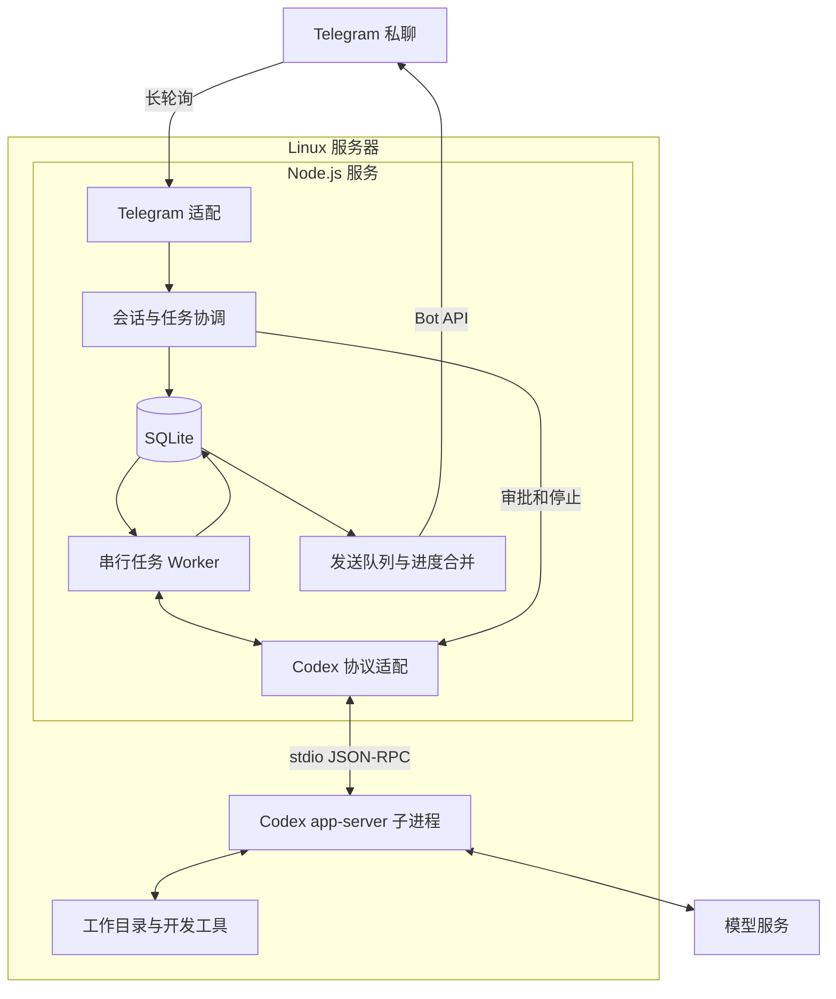

# Agent Relay 架构与技术选型

首版采用 Node.js 常驻服务，使用 grammY 接入 Telegram，使用 Codex app-server 执行任务，以 SQLite 保存会话、任务和发送记录。编码任务默认全局串行；状态、审批、补充输入和停止通过独立控制路径处理。

范围与验收见[产品需求文档](prd.md)。本方案面向个人使用，先实现 Telegram + Codex。其他 IM 与 Claude 等 Agent 是后续两个独立的扩展方向。当前已接通单会话执行、续聊、停止与持久化恢复；多会话、队列、审批和部署流程仍是后续目标。

当前实现沿用现有技术栈和单进程结构。入站去重、任务与 outbox 的事务一致性、单实例约束和最小停止能力随真实任务一起接入；没有增加运行依赖或测试文件。

## 核心架构决定

| 决策 | 首版方案 | 原因与边界 |
| --- | --- | --- |
| 服务形态 | 全局 npm CLI + 单进程 Node.js 后台服务，内部按职责分模块 | CLI 管理配置与启停，后台进程持续处理消息和任务 |
| CLI 与交互配置 | 计划使用 Commander + @clack/prompts | 提供子命令、帮助和配置向导；不引入通用依赖注入框架 |
| IM 框架 | grammY，Telegram 长轮询 | 入口是 Bot 消息与按钮；无需公网入站接口 |
| HTTP 框架 | 首版无需引入；需要 Webhook 或管理 API 时采用 Fastify | 避免为当前没有的 HTTP 业务增加服务层 |
| Codex 接入 | app-server，stdio 双向 JSON-RPC | 需要完整的会话、审批、问题和中断交互 |
| Codex 进程 | 一个受服务管理的常驻子进程，可承载多个已保存 thread | 首版任务串行，保持进程管理简单 |
| 数据 | SQLite + better-sqlite3 + Drizzle | 保存事务性状态与迁移；无需独立数据库服务 |
| 调度 | SQLite 任务记录 + 单个 Worker | 队列状态可恢复；控制消息不等待编码任务 |
| 消息发送 | 本地 outbox + 进度合并 | Telegram 故障不改变编码任务的执行结果 |
| 部署 | npm 全局安装，Linux 当前用户的 systemd 服务 | 配置向导完成初始化，服务管理器负责后台运行、重启和进程组 |
| 扩展 | 按 Agent、IM、核心业务和存储组织模块，共用必要的消息类型 | 保持职责清晰，不为分层额外引入基类、注册器或重复转发 |

Telegram 使用长轮询主动接收更新，Bot API 同时提供发送消息及按钮回调能力。[grammY 长轮询说明](https://grammy.dev/guide/deployment-types)

Codex app-server 提供线程、轮次、执行事件与审批交互；官方把需要这些能力的自定义客户端指向 app-server。它目前仍标记为实验性，因此 M0 必须固定 CLI 版本并验证协议，不能只凭类型定义判定兼容。[OpenAI 官方 app-server 文档](https://learn.chatgpt.com/docs/app-server)、[SDK 使用边界](https://learn.chatgpt.com/docs/codex-sdk)

## 框架与库

下列应用依赖已在 2026 年 10 月 28 日安装并固定至 lockfile；Codex 的目标 Linux 协议兼容性仍由 M0 验证。运行时和 Codex 升级分别验证，不在服务启动时自动追随 latest。

| 用途 | 选择 | 版本 / 状态 | 使用方式 |
| --- | --- | --- | --- |
| 运行时 | Node.js | 24.22.1 | `.nvmrc` 指定版本，通过 nvm 切换；ESM，生产运行编译后的 JavaScript |
| 包管理 | npm | 使用 Node.js 自带版本 | 提交 `package-lock.json`，使用 `npm ci` 安装 |
| 语言 | TypeScript | 7.0.2 | strict + NodeNext；类型检查与构建 |
| Telegram | grammy | 1.46.0 | 消息、命令、InlineKeyboard、回调、长轮询 |
| Telegram 重试 | @grammyjs/auto-retry | 2.0.2 | 429、5xx 最多重试两次；网络错误上抛；整次调用另设超时 |
| 数据库驱动 | better-sqlite3 | 13.0.3 | 本地 SQLite，短事务，启用 WAL |
| 数据访问 | drizzle-orm | 0.45.4 | 类型化表结构和查询 |
| 数据库迁移 | drizzle-kit | 0.31.11 | 生成迁移并纳入版本控制 |
| 数据校验 | zod | 4.6.7 | 配置及应用边界数据校验 |
| 日志 | pino | 10.4.0 | JSON 日志、关联标识与脱敏 |
| 开发运行 | tsx | 4.23.15 | 本地监听与调试；生产用 tsc 构建产物 |
| 测试 | 暂不引入 | 未安装 | 本轮仅进行静态检查、类型检查与编译验证 |
| 格式与静态检查 | @biomejs/biome | 2.6.3 | 保持一套格式化与 lint 工具 |
| Codex | Codex CLI | 本机检测到 0.165.0 | 目标 Linux 验证后固定；生成对应协议类型 |

Node.js 24 当前列为 LTS；grammY 提供 Node.js / TypeScript 开发路径。auto-retry 的 `maxDelaySeconds` 限制 Telegram 返回的 `retry_after`，不代表所有请求的总超时。当前安装版本的网络错误重试不消耗 `maxRetryAttempts`，因此显式启用 `rethrowHttpErrors`，并为整次调用设置可取消的截止时间。[Node.js](https://nodejs.org/en/download)、[grammY](https://grammy.dev/guide/getting-started)、[auto-retry](https://grammy.dev/plugins/auto-retry)

Drizzle 支持 better-sqlite3 驱动。当前文档示例包含 RC 安装命令，首版选用上表的稳定发布基线；迁移工具和 ORM 版本配套验证。better-sqlite3 使用同步接口，数据库事务应短小，不能在事务内等待 Codex 或网络。13.0.3 包内已包含常见平台的预编译二进制，目标 Linux 环境仍需验证驱动加载。[Drizzle SQLite](https://orm.drizzle.team/docs/sqlite/get-started-sqlite)、[better-sqlite3](https://github.com/WiseLibs/better-sqlite3)

库版本依据各包的 npm 元数据，可从 [grammy](https://www.npmjs.com/package/grammy)、[Drizzle](https://www.npmjs.com/package/drizzle-orm)、[better-sqlite3](https://www.npmjs.com/package/better-sqlite3)、[TypeScript](https://www.npmjs.com/package/typescript) 等包页面复核。工程配套使用 npm，@types/node 与 Node.js 24 对齐。

首版以 grammY 承担 IM 入口，新增轻量 CLI 层管理安装后的交互配置与后台服务。[Commander](https://github.com/tj/commander.js) 提供命令解析与帮助，[Clack](https://github.com/bombshell-dev/clack) 提供配置向导；两者尚未加入当前依赖。Fastify 留给后续 HTTP 入口；NestJS 的模块和依赖注入体系暂时没有对应需求。Codex 已承担 Agent 执行循环，因此首版直接接入其运行时。SQLite 中的任务记录是队列事实来源，当前规模无需 Redis / BullMQ。

## 分发与命令行入口

最终通过 `npm install -g agent-relay` 安装，再运行 CLI 完成交互配置和后台启动。以下为发布目标，当前仍通过仓库内的 npm scripts 开发运行。

| 命令 | 目标行为 |
| --- | --- |
| agent-relay setup | 交互填写 Bot Token、本人 ID、可选代理，检查 Codex 路径与运行环境；保存后可启动后台服务并设置开机自启 |
| agent-relay start | 检查配置、创建或更新本用户的服务定义并启动；重复调用不创建第二个实例 |
| agent-relay stop | 停止后台服务及受管理子进程，等待实际结束后报告结果 |
| agent-relay restart | 完成停止后重新启动；用于配置变更或 npm 升级后加载新版本 |
| agent-relay status | 查询服务管理器状态并展示配置、数据目录；不启动第二个业务进程 |
| agent-relay logs | 展示或跟随后台日志，凭据不进入命令行参数 |
| agent-relay run | 前台运行服务，供 systemd 和本地诊断使用；不进行交互配置 |
| agent-relay service uninstall | 停用并移除本应用的用户服务，保留配置和数据库；之后可通过 npm 卸载程序包 |

`setup` 由用户显式执行，npm 安装脚本仅承担包安装所需工作。交互取消时保留原配置，Token 使用隐藏输入；校验成功后再原子写入配置。CLI 的帮助、版本和状态命令不加载会执行迁移或启动轮询的业务入口。

发布时需调整现有 `private: true`，通过 `bin` 暴露带 Node shebang 的 CLI；使用 `files` 白名单包含编译产物和迁移文件，在打包前完成构建。安装用户不需要源码仓库、TypeScript 或 tsx。迁移资源相对包文件定位，用户配置与数据统一定位到当前用户的 `~/.agent-relay/`，任何命令均可从任意目录执行。[npm 包字段](https://docs.npmjs.com/cli/v11/configuring-npm/package-json/)

发布验收使用实际 `npm pack` 产物，在临时安装前缀全局安装后，从包外目录调用 CLI；检查 bin、运行依赖、迁移资源及目标 Linux 的 SQLite 驱动。升级前停止服务并备份数据，升级后重新解析 Node 与包入口路径、更新服务定义并启动；数据库迁移失败时保留数据并报告失败。

## 模块组织与依赖方向

| 模块 | 职责 |
| --- | --- |
| src/cli.ts（规划） | CLI 命令解析、配置向导和服务管理；只在 run 时进入后台业务入口 |
| src/main.ts | 组装组件、数据库迁移、启动和退出；只在这里选择具体 IM 与 Agent |
| src/config.ts、src/logger.ts | Telegram 凭据与本人身份校验、结构化日志 |
| src/im/telegram.ts | grammY 接入、本人验证、入站标准化、回复与连接生命周期 |
| src/agents/codex.ts | Codex app-server 连接、协议校验、会话创建或恢复、执行与中断 |
| src/core/service.ts | 平台无关的命令处理、单会话协调和串行任务执行 |
| src/core/types.ts | 实际跨模块复用的来源、消息、Agent 接口和执行结果 |
| src/storage/index.ts、src/storage/schema.ts | SQLite 连接、自动迁移、表结构和实际需要的存储操作 |
| src/storage/migrate.ts | 独立迁移入口，不依赖 Telegram 凭据 |
| migrations/ | 受版本控制的 SQL 迁移与 Drizzle 元数据 |

Telegram SDK 类型仅在 IM 连接模块使用，Codex RPC 类型仅在 Agent 模块使用。核心层只处理应用自己的消息与回复，通过存储模块暴露的操作读写状态；不直接使用 grammY、Drizzle 或 Codex 协议。IM 来源标识统一为字符串，避免把 Telegram 数字 ID 的假设带到其他平台。

当前依赖关系为 `main → 组件组装`，`im → 统一消息处理入口 → core → 存储操作`。核心层通过 `Agent` 接口执行和停止任务，IM 独立读取 outbox 发送回复。Worker 保留在核心模块，协议处理保留在 Agent 模块，不额外拆出转发层。

按实际复用抽取函数和共享类型，新增前检查现有定义。避免为单一用途拆出多层 Controller / Service / Repository、抽象基类和通用插件注册器；对公开函数、关键逻辑和必要常量添加简洁中文 JSDoc。

## 入站消息与执行流程

以下是任务链路。当前已实现入站去重、任务及回复的事务提交、独立执行和发送；进度合并与编辑留到后续。回调应答只负责关闭客户端提示，不创建任务。

1. grammY 收到 Update，先验证授权用户和私聊范围。

2. 标准化消息保留平台、账号、事件 ID、消息 ID、回复目标和命令参数。使用平台 + 账号 + 事件 ID 去重，在同一 SQLite 事务中保存入站记录、任务及回执发送意图，并在创建任务时固定会话和工作目录快照。重复事件返回已有结果，不重复创建任务。

3. 事务提交后结束入站处理，把耗时执行交给 Worker；不能在 Bot handler 中等待整个 Codex turn。

4. Worker 在事务中把 queued 任务领取为 dispatching，读取该任务在接收时已经固定的会话和工作目录快照。

5. 创建或恢复 Codex thread，发送 turn/start，记录 threadId 和 turnId。

6. 事件更新任务状态，并合并为进度发送意图；完成后保存最终结果和最终通知。

7. delivery 独立发送或编辑 Telegram 消息，按失败类别重试。

入站持久化失败时停止拉取新批次并退出恢复。当前连接器使用 `getUpdates` 和 `handleUpdate` 显式维护 offset，只有处理成功才推进；不使用会自动删除 Webhook 的 `bot.start` 或会确认最后一次尝试消息的 `bot.stop`。收到关停信号后取消读取，等待当前处理结束，不额外确认更新。失败消息和未处理批次保留重投机会，成功但尚未确认的消息也可能重投，因此不能替代 M1 的数据库去重。[Telegram 更新接收规则](https://core.telegram.org/bots/api#getupdates)、[grammY 生命周期](https://grammy.dev/ref/core/bot)

当前按聊天来源与事件 ID 去重，重复事件不会重新创建任务或回执。发送成功但响应丢失时，outbox 重试可能产生重复通知。Telegram 不提供无限期保留更新的保证，长期离线后的恢复不能只依赖服务端消息队列。

控制路径包括 /status、/stop、审批回调、明确回复补充问题。它们不进入编码任务队列。等待审批占用当前编码任务槽，但不会占用 Node.js 事件循环。入站处理只做短事务和控制派发，不等待 Codex 完成或普通 Telegram 消息发送，避免慢请求把后续停止指令堵在同一批次中。

当前通过 `/cwd 绝对路径` 设置目录并规范化真实路径，未设置时提示补充，不隐式使用 Relay 自身目录。任务保存提交时的 cwd 和 session_id；执行前再次检查目录。任务未结束时不能切换目录或 `/new`，目录变化会开始新会话。后续多会话模型再引入独立 conversation_id，不增加目录白名单。

当前全局最多一个未结束任务，由数据库部分唯一索引约束；忙碌时新消息明确提示未提交。待执行队列留到后续，建议上限 20。未来开启并行时，必须增加按可写工作区的互斥；有多个 thread 并不意味着可以同时修改同一目录。

## 会话与数据模型

当前不实现项目列表或项目选择，也不要求 `projects.json`。Relay 不设置项目目录白名单；任务执行使用用户指定并由当前会话沿用的工作目录。

当前创建 `channels`、`inbound_updates`、`tasks`、`outbox` 四张业务表。channels 保存当前 cwd、session_id 和 paused；tasks 保存目录与会话快照、任务输入、最终结果和执行状态；outbox 保存分段回复及重试时间。下面的独立 conversations、interactions 和完整队列字段随多会话与审批功能加入。

应用 conversation ID 与 Codex thread ID 分开保存。同一个聊天可新建和继续多个 conversation，各自保留 Agent 上下文和工作目录。首版不支持将一个现有会话切换为另一个 Agent。

| 表 | 核心数据与约束 |
| --- | --- |
| channels | platform、account_id、chat_id、user_id、当前会话、queue_paused；来源组合唯一，首版不支持 topic |
| conversations | 应用 ID、来源聊天、cwd、agent_type、agent_session_id、标题和最后使用时间；首版 agent_type 为 codex |
| inbound_updates | platform、account_id、event_id、接收时间及必要标准化内容；组合唯一，用于防重复处理 |
| tasks | conversation_id、来源更新、cwd 快照、输入、status、turn_id、结果、错误及时间；来源更新唯一，重试必须由新事件另建记录并保存原任务 ID |
| interactions | task_id、类型、RPC request ID、进程 generation、操作者、状态、有效期和答案；generation 与 RPC request ID 组合唯一，可保存多个并发请求 |
| outbox | 聊天目标、task_id、发送类别、文本、Telegram message_id、版本、重试时间及状态；业务发送键唯一 |

SQLite 开启 WAL、外键和适当 busy_timeout。同步查询保持短小；按任务状态和创建时间建立领取索引，按会话和时间建立查询索引。Worker 在事务内检查全局活动槽并条件领取任务，不能先查询 queued 后再无条件更新。会话、任务、交互和发送记录使用外键关联；历史清理不能删除仍被引用或尚未完成的记录。

完整 Agent 上下文继续由 Codex 管理。应用保存路由关系、任务输入、最终输出及必要摘要，不把所有 token delta 永久写入数据库。历史查询通过运行时支持的接口完成，避免依赖 Codex 私有数据库格式。

## Codex 协议与生命周期

Node.js 使用内置 child_process.spawn 启动 codex app-server，参数以数组传入且 shell 为 false。使用 stdin/stdout 的 JSONL 承载双向 RPC，线上消息省略 `jsonrpc` 字段；stderr 只提取必要诊断，不把可能含正文或凭据的原始内容直接转存。stdout 不能混入应用日志。

每个连接先发送 `initialize` 并等待响应，再发送 `initialized` 通知，之后才能创建或恢复 thread；普通消息启动 turn；中断通过 turn/interrupt 请求。只根据 turn/completed 的实际状态判定完成、失败或中断。请求超时、进程退出和没有收到事件，都不等价于成功。[协议与生命周期](https://learn.chatgpt.com/docs/app-server)

当前每个任务创建独立 app-server 子进程，按持久化 thread ID 恢复上下文。RPC、事件和待响应请求随该进程隔离；核对 threadId 与 turnId，允许事件早于 turn/start 响应。使用 Codex 0.165.0 的 generate-ts 输出核对消费字段，并在运行时用 Zod 校验；没有将整套生成类型复制进仓库。返回结果前等待进程退出；POSIX 下同时清理受管理进程组。

| 协议工作 | 首版要求 |
| --- | --- |
| 类型 | 由固定版本 CLI 的 generate-ts 生成；应用边界另做必要运行时校验 |
| 请求关联 | 使用请求 ID 关联 Promise；RPC 响应、事件通知、服务端请求分别分发 |
| 多会话路由 | 每次启动生成跨服务重启也不重复的 generation，同时核对 threadId、turnId 和当前 task；尚未拿到 turnId 的早到事件暂存后关联 |
| 事件次序 | 允许通知早于 RPC 响应；终态不能被迟到响应改回 running |
| 文本与工具事件 | 文本增量累积，工具事件转摘要；限制单行、待关联事件和待发送缓冲，处理 stdin 背压；溢出时明确中断，不能静默丢失终态 |
| 未支持请求 | 明确返回不支持并提示用户，不悄悄批准，也不无限等待 |
| 子进程异常 | 清理该 generation 的待响应请求；活动任务进入 interrupted |
| 重新启动子进程 | 仅恢复通信和已保存会话入口；不会自动重发上次 turn/start |

M0 要验证当前运行时的普通文本澄清问题如何呈现。若问题并非结构化事件，按普通回复展示，用户下一条消息自然续聊；不靠关键词猜测并伪造一个权限请求。

Codex 模型、provider 和认证优先沿用服务用户已有配置。应用只覆盖明确设置的选项；模型列表不能作为实际账号可用性的保证。

## 审批与补充输入

当前最小链路尚无审批与结构化提问界面，收到服务端交互请求时返回不支持并中断任务，保存提示；不会自动批准或一直等待。下文为后续完整交互方案。

每个待处理交互都有独立的应用 ID。Telegram callback_data 只携带短的随机标识和选择，完整 RPC ID 及上下文保存在数据库和当前运行时中。按钮处理同时校验本人身份、聊天来源、任务、进程 generation、有效期和未处理状态。

用户点击后及时答复 callback query，同时以条件更新领取该选择，成功领取后才发送对应 RPC 响应。按钮应答只是关闭客户端等待提示，不是授权提交依据；应答超时或回调过期不能阻止已经持久化的决定转发，也不能触发第二次转发。旧按钮、重复点击或进程已经更换时只提示失效，不向新的任务发送任何答案。[Telegram 按钮回调](https://core.telegram.org/bots/api#callbackquery)

| 交互类型 | 处理方式 |
| --- | --- |
| 命令或文件操作审批 | 根据运行时允许的选项映射允许、拒绝或取消；首版以单次授权为主 |
| 网络或文件系统权限请求 | 仅返回所批准的权限子集，作用域限制到当前请求所允许的范围 |
| 结构化用户问题 | 按 question ID 保存和返回答案；支持选项及明确回复 |
| 未支持的表单、URL 或动态工具请求 | 明确说明限制，返回相应拒绝或不支持结果，提供停止入口 |

具体响应结构以该版本生成的协议为准，不能对所有类型套用同一个 accept / decline 对象。应用默认审批有效期建议 10 分钟；运行时若给出更早的自动解决时限，采用较早期限；请求解决、取消或 turn 结束时立即使对应按钮失效。服务端已解决通知、超时和用户点击发生竞争时，至多转发一个决定。领取成功到 RPC 写入之间发生故障时记录不确定状态，不自动重放批准；重建进程后作废旧交互。

默认拟用工作区可写与按需审批。它保留 Codex 的实际权限判断；应用不会把“全部允许”作为默认运行模式。

## 任务状态与恢复语义

| 状态 | 含义及允许的后续动作 |
| --- | --- |
| queued | 已持久化，尚未向 Codex 派发；可取消或等待领取 |
| dispatching | 即将或已经发送启动请求，执行结果仍可能不确定 |
| running | 已确认执行中 |
| waiting_approval | 存在阻塞执行的待审批请求 |
| waiting_input | 存在阻塞执行的结构化补充问题 |
| cancelling | 已发起停止，尚未确认终止 |
| completed | 运行时明确确认成功完成 |
| failed | 运行时明确返回失败，或应用确认尚未派发执行便发生不可恢复错误 |
| cancelled | 排队任务被取消，或用户停止后收到确定的中断终态 |
| interrupted | 连接或进程故障导致执行状态无法确认 |

普通路径为 queued → dispatching → running → completed / failed。等待交互解决后返回 running；仍有其他阻塞请求时继续等待。非阻塞问题保持 running，并单独显示待回答交互。终态记录不可被迟到事件覆盖。

停止操作把当前聊天的 queue_paused 设为 true，请求中断活动 turn 并作废其待处理按钮。收到实际终态后再更新界面。无法确认退出时，先结束受管理进程组并记录 interrupted；确认没有旧进程继续写入后，才允许恢复后续任务。

正常关停先停止入站轮询、保存已接收数据，再请求活动任务中断并等待退出。异常重启后，queued 记录保留；dispatching、running、waiting_approval、waiting_input 和 cancelling 统一进入 interrupted，旧交互失效。与异常任务相关的队列保持暂停，用户检查已有结果后明确选择继续。

恢复上下文可以使用保存的 Agent 会话 ID；原来的活动 RPC 等待不能跨进程恢复。继续或重试创建新的 task，保留与原任务的关联。

一致性目标是：同一入站事件只创建一个任务，明确的终态只生效一次，结果不确定的执行不自动重放。Telegram、数据库和 Codex 之间没有共同事务，因此不宣称端到端 exactly-once。

尤其在“Codex 已收到 turn/start，但数据库尚未记下 turnId”这一窗口崩溃时，必须保留不确定状态，不能因为没拿到响应就自动重发。

## Telegram 输出与故障恢复

delivery 从 outbox 读取已持久化的发送意图。接收回执、审批和最终结果优先于普通进度；进度只保存最新待发送版本，默认每 2 秒最多编辑一次同一条消息。

首版输出纯文本和 InlineKeyboard，避免流式半段内容导致格式解析失败。长回复按段落和安全长度分块，保证最终内容完整；状态信息只包含用户有用的会话、工作目录、进度与操作，不展示 RPC ID 等内部实现标识。

Telegram 429 按 retry_after 等待；其他可恢复的网络错误使用有限次数退避重试。超过当前尝试上限后保留 outbox，稍后恢复发送。对“已经发送但响应丢失”的场景，Telegram 侧可能出现重复通知，应用不能据此重跑编码任务。

auto-retry 仅用于 Telegram API。普通请求总时限为 15 秒，长轮询为 40 秒；单次调用中 429、5xx 最多重试两次，长等待或网络错误交给外层处理。发送失败由 outbox 持久化退避时间，429 遵守 retry_after；永久拒绝记录为 failed，401、轮询或存储故障退出服务。接收与发送循环独立，等待发送不会阻塞控制消息。Codex turn/start 不自动重试。

进度发送积压不能阻塞 Codex 事件读取。等待审批时遇到 Telegram 断线，保留请求至有效期；恢复后只重发仍有效的交互，不复活过期按钮。

## 配置与部署

当前源码开发仍读取 `.env`，数据库位于仓库的 `data/agent-relay.db`。全局安装后的目标是由配置向导写入用户配置，配置、数据库和锁统一保存在当前用户主目录下的 `.agent-relay/`；下表为计划中的发布布局，尚未落地到当前代码。

| 配置项 | 保存位置与约束 |
| --- | --- |
| 用户配置 | `~/.agent-relay/config.json`；目录权限 0700，文件权限 0600 |
| Telegram Bot Token 与本人 ID | 由 setup 写入配置，保留环境变量覆盖能力；不依赖可修改的 username |
| Telegram 代理 | 保存明确的代理配置；后台进程不依赖启动终端的临时环境。向导可提示采用当前终端代理 |
| 工作目录 | 后续由任务或会话指定，不设置目录白名单 |
| Codex 命令 | 配置时解析可执行文件的绝对路径；与后台服务使用同一 OS 用户，沿用其认证与配置 |
| 应用数据库 | `~/.agent-relay/agent-relay.db`；单实例锁位于同目录的 `agent-relay.db.lock` |
| 日志级别 | 当前固定为 info |
| 队列与交互设置 | 规划默认并发 1、队列上限 20、审批 10 分钟、进度间隔 2 秒；当前未实现，不预建配置项 |

`~/.agent-relay/` 按当前运行用户的主目录解析为绝对路径；CLI 与后台服务使用同一用户和同一目录，不受执行命令时的 cwd 影响。数据库、锁和配置不得写到全局 npm 包目录，避免升级覆盖、权限问题和从不同 cwd 启动产生多份数据。

后台方案以支持 systemd 用户服务的 Linux 为目标，CLI 生成本用户的服务定义，通过 `systemctl --user` 管理，日志交给 journal。ExecStart 使用解析后的 Node 和 CLI 绝对路径执行 `agent-relay run`；后台任务的 cwd 由会话单独指定。设置 Restart=on-failure、重启退避和 KillMode=control-group；停止等待须覆盖入站处理和子进程退出期限。[systemd 服务](https://www.freedesktop.org/software/systemd/man/latest/systemd.service.html)

退出 SSH 后继续运行或开机自启需要检查用户 linger 状态。向导说明设置并在系统权限允许时完成；权限不足时给出所需命令，不能报告后台持久运行已配置成功。不支持 systemd 用户服务的环境仍可使用前台 run，由外部进程管理器托管；首版不自行实现通用守护进程管理器。[loginctl linger](https://www.freedesktop.org/software/systemd/man/latest/loginctl.html)

M1 启动 Worker 前必须取得同一数据库对应的排他运行锁，取得锁后才进行恢复；不能把 Telegram 的 409 冲突当成编码任务互斥。锁须独立于 CLI 命令进程，使前台 run 与后台服务同样不能重复运行。

当前在数据库旁的 `.lock` SQLite 文件上持有独立排他事务，进程退出自动释放；数据库迁移和恢复都在取得锁后进行。发送与任务领取按机器人账号和授权用户过滤，避免更换配置后处理旧账号的待办。

Codex 子进程只接收必要环境与运行时凭据，不默认继承 Telegram Token。Relay 直接向 Agent 传递任务工作目录，不通过项目清单限制目录；实际文件访问仍沿用 Codex 与 OS 的权限配置。

当前启动检查包括 Telegram 配置、单实例锁、数据库迁移、Codex CLI 版本格式、Telegram 连接和 Webhook 状态；认证与模型访问在实际任务调用时验证，失败会保存并回复。已在本机通过真实 Codex 调用，目标 Linux 的 M0 仍待验证。遇到 Webhook 或另一轮询实例时给出明确错误，不自动接管其他部署；日志不记录原始凭据或网络 URL。

备份使用 SQLite 在线备份机制，并保留对应 Codex 会话数据；启用 WAL 时不能仅复制一个正在写入的 .db 文件。应用数据库的普通恢复与 Codex 认证凭据管理分别处理。

日志使用 Pino，携带 task_id、conversation_id 和阶段；默认不记录完整 prompt、Token 或原始环境变量。首版通过 /status 和 systemd / journalctl 诊断，暂不提供公网管理接口。

## 后续扩展规则

其他 IM 的新增工作集中在消息与回调标准化、发送与编辑能力、身份绑定和限流。新平台接入后，复用会话、任务、交互和恢复流程；默认新建独立的聊天绑定。跨 IM 共享同一个会话必须通过显式绑定，不能只因用户名相同自动合并。

Claude 等 Agent 的新增工作集中在会话创建或恢复、任务输入、执行事件、审批与停止。计划中的 conversations 表将保存 agent_type 和 agent_session_id；当前数据库尚无这些字段。两种 Agent 的原生上下文不能直接互换，切换运行时应新建会话。

新增 IM 或 Agent 时，先在对应目录新增实现，复用已有消息与业务边界；只有出现实际重复逻辑时再抽取公共接口，并明确能力差异。首版不实现动态加载插件、远程 Worker 集群或通用 Agent 编排。

## 验证与交付标准

以下为完整功能验收目标。按当前要求，不添加测试文件、测试命令或测试依赖；开发验证使用检查、构建与临时工作区中的运行检查。目标 Linux 和尚未实现的功能需独立验收。

| 验证层 | 重点 |
| --- | --- |
| 协议契约 | 初始化、创建与恢复会话、增量事件、审批、问题、中断；固定版本的合法响应结构 |
| 状态与数据库 | 入站唯一键、任务领取、迟到事件、审批竞争、终态不可回退 |
| 故障恢复 | 数据库提交失败、子进程退出、启动响应丢失、父进程重启、旧按钮点击 |
| Telegram | 429、网络错误、长文本、编辑失败、重复 Update、快速回调确认 |
| 控制响应 | Codex 持续运行或等待审批时，状态查询与停止仍可用 |
| 端到端 | 两个临时工作目录、多轮对话、拒绝审批、停止、重启后恢复、连续运行 |

已在 macOS、Node.js 24.22.1、Codex CLI 0.165.0 的临时工作区验证真实回复、跨进程会话恢复和 turn/interrupt；临时 SQLite 验证覆盖单实例锁、入站去重、忙碌时控制、会话保存与中断恢复。未向真实 Telegram 聊天发送验证消息，也未完成目标 Linux 的完整 M0 验证。
